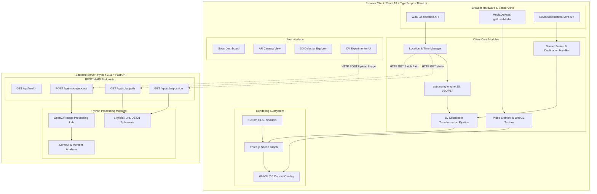
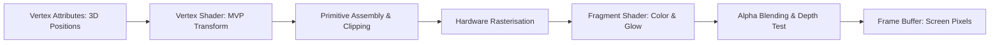
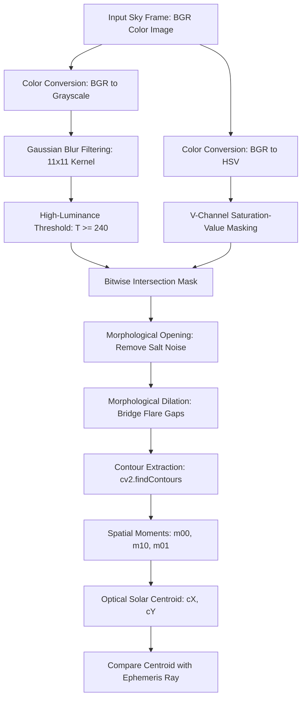

# SkyGazer AR: Technical Research, Mathematical Foundation, and Architectural Specification
**A University-Level Computer Graphics and Image Processing (CGIP) Research Project**

---

## Document Control Metadata
- **Project Title:** SkyGazer AR (Browser-Based Solar Tracking & Augmented Reality System)
- **Document Type:** Comprehensive Technical Research & Architectural Specification
- **Academic Level:** 3rd/4th-Year Computer Science & Engineering (Computer Graphics & Image Processing Track)
- **Target Architecture:** Decoupled Hybrid Client-Server (React/TypeScript/WebGL/Three.js + Python/FastAPI/OpenCV/Skyfield)
- **Status:** Final Research Baseline

---

## Table of Contents
1. [Section 1: Executive Summary](#section-1-executive-summary)
2. [Section 2: Problem Statement](#section-2-problem-statement)
3. [Section 3: Project Objectives](#section-3-project-objectives)
4. [Section 4: Existing Solutions and Research Gap](#section-4-existing-solutions-and-research-gap)
5. [Section 5: Functional Requirements](#section-5-functional-requirements)
6. [Section 6: Non-Functional Requirements](#section-6-non-functional-requirements)
7. [Section 7: System Architecture](#section-7-system-architecture)
8. [Section 8: Astronomical Mathematics](#section-8-astronomical-mathematics)
9. [Section 9: Coordinate Systems and Transformations](#section-9-coordinate-systems-and-transformations)
10. [Section 10: Device Orientation and Sensor Fusion](#section-10-device-orientation-and-sensor-fusion)
11. [Section 11: Camera Geometry and Projection](#section-11-camera-geometry-and-projection)
12. [Section 12: Computer Graphics and WebGL](#section-12-computer-graphics-and-webgl)
13. [Section 13: OpenCV and Image Processing](#section-13-opencv-and-image-processing)
14. [Section 14: Solar Trajectory](#section-14-solar-trajectory)
15. [Section 15: API Design](#section-15-api-design)
16. [Section 16: Frontend Design](#section-16-frontend-design)
17. [Section 17: Security and Privacy](#section-17-security-and-privacy)
18. [Section 18: Research Questions and Hypotheses](#section-18-research-questions-and-hypotheses)
19. [Section 19: Experimental Methodology](#section-19-experimental-methodology)
20. [Section 20: Development Roadmap](#section-20-development-roadmap)
21. [Section 21: Proposed Repository Structure](#section-21-proposed-repository-structure)
22. [Section 22: Testing Strategy](#section-22-testing-strategy)
23. [Section 23: Risks and Limitations](#section-23-risks-and-limitations)
24. [Section 24: Future Enhancements](#section-24-future-enhancements)
25. [Section 25: References](#section-25-references)
26. [Section 26: Glossary](#section-26-glossary)

---

## Section 1: Executive Summary

### 1.1 What SkyGazer AR Is
**SkyGazer AR** is an interactive, browser-accessible augmented reality and astronomical visualization system designed for desktop and mobile platforms. The system ingests an observer's geographic coordinates (latitude, longitude, elevation) and a temporal timestamp to calculate the Sun's precise topocentric celestial position (azimuth and altitude). It then projects a synthetic, mathematically grounded virtual Sun marker and diurnal trajectory over a live video stream captured by the client device's camera.

### 1.2 The Problem It Addresses
Bridging theoretical astronomical mechanics with real-world spatial vision presents significant engineering hurdles in modern web applications:
- Simple ephemeris calculations yield abstract angular coordinates that cannot directly locate an object on a screen without modeling camera optics and device attitude.
- Mobile Web browser environments impose severe hardware sandboxing: raw sensor streams (accelerometers, gyroscopes, magnetometers) are noisy, drift-prone, subject to local magnetic anomalies, and inconsistent across device vendors.
- Traditional computer vision algorithms for tracking the Sun via optical sensor data (brightness thresholding) suffer catastrophic false positives from specular reflections, cloud edges, and lens flare.

### 1.3 The Proposed Solution
SkyGazer AR solves these challenges through a mathematically rigorous pipeline:
1. **High-Precision Ephemeris Engine:** Combines VSOP87/NOVAS planetary theory in the browser client for real-time (60 FPS) rendering with high-accuracy NASA JPL ephemerides (via Python Skyfield/DE421) on the backend for astronomical verification.
2. **Standardized Coordinate Transformation Pipeline:** Unifies astronomical horizontal coordinates, East-North-Up (ENU) world frames, device attitude quaternions, and pinhole camera projective geometry ($SE(3) \to \mathbb{P}^2$).
3. **Hybrid Computer Vision Lab:** Employs an OpenCV-based image-processing testbed that extracts bright-region candidates through adaptive thresholding and spatial moments, measuring angular divergence against the predicted ephemeris vector.

### 1.4 Intended Users
- **Undergraduate & Postgraduate Students:** Learning foundational concepts in Computer Graphics (MVP matrix cascades, projective geometry, shader pipelines) and Image Processing (morphological operations, segmentation, color-space filtering).
- **Educators & Researchers:** Demonstrating sensor fusion, ephemeris accuracy, and mobile web AR limitations.
- **Astronomy Enthusiasts:** Seeking accessible, browser-native tools for daylight solar tracking and trajectory simulation without proprietary native app installations.

### 1.5 Academic Value of the Project
SkyGazer AR bridges three core disciplines:
- **Astronomy & Geodesy:** Universal Time (UTC), Greenwich Mean Sidereal Time (GMST), topocentric parallax, and atmospheric refraction.
- **Computer Graphics:** Pinhole camera intrinsic/extrinsic calibration, homogeneous coordinate pipelines ($4\times4$ transformation matrices), quaternion attitude representation, WebGL/Three.js rendering pipelines, and custom GLSL vertex/fragment shaders.
- **Computer Vision & Image Processing:** Optical calibration ($K$-matrix estimation), lens distortion rectification, morphological filtering, connected-component analysis, and geometric spatial moment analysis.

### 1.6 Expected Final Deliverable
A fully reproducible, open-source web application consisting of:
- A responsive **React 18 + TypeScript + Three.js** frontend with dark-mode astronomical UI (Tailwind CSS, shadcn/ui components).
- A high-performance **Python 3.11 + FastAPI** backend supplying ephemeris verification, trajectory generation, and an OpenCV image-processing microservice.
- A comprehensive **experimental testbed** for quantitatively measuring alignment error, sensor latency, and image segmentation accuracy under controlled conditions.

---

## Section 2: Problem Statement

### 2.1 The Alignment Challenge
The fundamental technical challenge of augmented reality celestial navigation is establishing an exact spatial correspondence between a theoretical celestial body direction vector $\mathbf{v}_{\text{celestial}} \in \mathbb{R}^3$ and a pixel coordinate $\mathbf{p} = [u, v]^T \in \mathbb{R}^2$ on an arbitrary digital camera sensor.

Calculating the Sun’s topocentric altitude ($h$) and azimuth ($A$) yields a direction in the local horizontal topocentric coordinate system. However, projecting this point onto the device screen requires answering four coupled geometric questions:
1. **Where is the observer?** (Geodetic position on the WGS84 ellipsoid).
2. **What time is it with astronomical rigor?** (UTC converted to Terrestrial Time and Barycentric Dynamical Time, accounting for Earth's rotation and axial tilt).
3. **How is the device oriented in 3D physical space?** (Estimating the attitude rotation matrix $\mathbf{R}_{\text{device}}^{\text{world}} \in SO(3)$ using noisy inertial and magnetic sensors).
4. **What are the optical properties of the camera?** (Focal lengths $f_x, f_y$, principal point $(c_x, c_y)$, and lens distortion coefficients $k_1, k_2, p_1, p_2$).

```
[Astronomical Ephemeris (Skyfield / VSOP87)]
                     │
                     ▼
  Local Horizontal Vector s_world (ENU Frame)
                     │
                     ▼  <──  Device Orientation R_world_to_cam (IMU / Magnetometer)
  Camera Coordinate Vector s_cam
                     │
                     ▼  <──  Camera Intrinsic Matrix K (fx, fy, cx, cy)
  Normalized Image Plane (x_n, y_n)
                     │
                     ▼  <──  Distortion Model (Radial / Tangential)
  Screen Pixel Coordinates (u, v) [AR Sun Marker Overlay]
```

### 2.2 Why Astronomical Position Is Insufficient Alone
An astronomical algorithm alone computes only the line of sight from the observer's physical location. It does not possess knowledge of:
- The device's dynamic orientation relative to true geographic north and the gravitational vector.
- The optical perspective transformation imposed by the camera lens.
- The temporal lag (latency) between inertial sensor reads and video frame presentation.

### 2.3 Integrated System Roles
To achieve coherent augmented reality, five modular subsystems must cooperate:
1. **Astronomical Mechanics:** Computes instantaneous solar declination, Greenwich hour angle, and topocentric horizontal altitude and azimuth, applying corrections for atmospheric refraction.
2. **Device Orientation & Attitude Estimation:** Ingests Web `DeviceOrientationEvent` sensor streams, calibrates for magnetic declination (True North vs. Magnetic North), and synthesizes a drift-compensated rotation quaternion $\mathbf{q}$.
3. **Camera Geometry & Optics:** Formulates the camera intrinsic matrix $\mathbf{K}$ and extrinsic transformation $[\mathbf{R} \mid \mathbf{t}]$ to project 3D directional rays into 2D homogeneous pixel coordinates.
4. **Digital Image Processing:** Analyzes optical video frames through OpenCV pipelines (luminance thresholding, HSV segmentation, contour extraction, image moments) to locate physical brightness centroids and quantify optical-to-mathematical angular divergence.
5. **Real-Time Graphics Pipeline:** Employs WebGL / Three.js to render a celestial sphere, coordinate grid lines, diurnal path splines, and interactive 3D overlays at 60 FPS without blocking the browser main thread.

---

## Section 3: Project Objectives

### 3.1 Functional Objectives
- **FO-1:** Ingest observer geodetic coordinates (latitude, longitude, elevation) automatically via the W3C Geolocation API or manual override.
- **FO-2:** Ingest timestamps (current real-time or user-specified simulation time) with full ISO 8601 and UTC timezone awareness.
- **FO-3:** Calculate instantaneous solar azimuth and altitude with an algorithmic precision exceeding $\pm 1$ arcminute ($\approx 0.016^\circ$).
- **FO-4:** Stream live camera video via the `MediaDevices.getUserMedia()` browser API with user-selectable resolutions (720p, 1080p).
- **FO-5:** Track device attitude in real time using the `DeviceOrientationEvent` API, supporting Euler angles and rotation matrices with fallback sliders for desktop testing.
- **FO-6:** Render a dynamic virtual Sun marker overlaid directly upon the live camera stream with smooth spatial tracking.
- **FO-7:** Provide an interactive 3D Celestial Sphere mode permitting free camera orbit, displaying compass cardinals, local horizon planes, and full diurnal solar trajectories.
- **FO-8:** Implement a computer vision analysis suite enabling users to upload sky images or capture live camera frames to detect bright solar candidates using OpenCV.

### 3.2 Computer Graphics Objectives
- **CGO-1:** Implement a strict Model-View-Projection (MVP) matrix cascade adhering to standard graphics pipeline conventions:
  $$\mathbf{v}_{\text{clip}} = \mathbf{P}_{\text{proj}} \cdot \mathbf{V}_{\text{view}} \cdot \mathbf{M}_{\text{model}} \cdot \mathbf{v}_{\text{local}}$$
- **CGO-2:** Construct custom GLSL shaders (vertex and fragment) demonstrating hardware rasterization, directional lighting, and alpha-blended additive glow for the virtual Sun marker.
- **CGO-3:** Maintain consistent 60 frames per second (FPS) rendering on modern mobile and desktop browsers using WebGL/Three.js render loops.
- **CGO-4:** Render mathematically exact 3D parametric spline curves representing the diurnal solar path across 24 hours, dynamically segmented into above-horizon (visible) and below-horizon (sub-horizon) visual styles.

### 3.3 Image-Processing Objectives
- **IPO-1:** Implement modular OpenCV image-processing pipelines for:
  - Color space transformations: $\text{BGR} \to \text{Grayscale}$, $\text{BGR} \to \text{HSV}$, and $\text{BGR} \to L^*a^*b^*$.
  - Adaptive and global thresholding (Otsu's binarization, fixed high-luminance truncation).
  - Morphological filtering (structuring element generation, morphological opening to remove salt noise, dilation to fuse fragmented sun glare).
  - Connected component analysis and contour detection (`cv2.findContours`).
- **IPO-2:** Calculate spatial image moments ($m_{00}, m_{10}, m_{01}$) to determine the candidate solar centroid $(\bar{x}, \bar{y})$:
  $$\bar{x} = \frac{m_{10}}{m_{00}}, \quad \bar{y} = \frac{m_{01}}{m_{00}}$$
- **IPO-3:** Quantify the pixel Euclidean displacement and angular divergence between the OpenCV-detected centroid and the mathematically predicted solar projection.

### 3.4 Research Objectives
- **RO-1:** Quantify the accuracy trade-offs between browser-side JavaScript ephemeris computation (`astronomy-engine`) and backend Python ephemeris libraries (`Skyfield` with NASA JPL DE421 ephemeris).
- **RO-2:** Measure the impact of mobile magnetometer drift and magnetic declination on augmented reality angular alignment error.
- **RO-3:** Quantify the sensitivity of camera intrinsic assumptions (default estimated field of view vs. calibrated pinhole focal length) on marker displacement.
- **RO-4:** Evaluate the failure modes of pure image-processing solar detection under diverse sky conditions (clear sky, high-altitude cirrus clouds, direct overcast, artificial specular glares).

### 3.5 Performance Objectives
- **PO-1:** **Client Render Loop:** $\ge 60$ FPS on modern mobile devices (iPhone 12+, Samsung Galaxy S21+, modern laptops).
- **PO-2:** **Backend Ephemeris API Latency:** $t_{95} \le 50\text{ ms}$ for single solar position queries; $t_{95} \le 150\text{ ms}$ for full 24-hour diurnal trajectory arrays (96 points).
- **PO-3:** **Backend Vision Pipeline Latency:** $t_{95} \le 250\text{ ms}$ for 1080p image upload, grayscale conversion, morphological filtering, and contour extraction.
- **PO-4:** **Zero Main-Thread Blocking:** Maintain responsive UI interaction by decoupling DOM events from sensor listener callbacks and WebGL rendering passes.

---

## Section 4: Existing Solutions and Research Gap

### 4.1 Survey of Established Sky-Viewing Applications
Commercial and open-source sky-mapping tools have existed for decades. Prominent applications include:

| Application | Platform | Primary Ephemeris / Engine | Core Features | Limitations from an Academic CGIP Perspective |
|---|---|---|---|---|
| **Stellarium** | Desktop (C++/OpenGL), Web (Wasm) | Custom VSOP87 / JPL DE430 implementation | Full planetarium, high-fidelity sky simulation, atmospheric scattering | Massive codebase; monolithic C++ architecture; not designed as an educational CGIP pipeline tool. |
| **SkyView / Star Walk** | Mobile Native (iOS / Android) | Proprietary native sensor fusion + ephemeris | Smooth sensor-based mobile AR, gyroscope smoothing, 3D celestial models | Proprietary closed-source; black-box coordinate transformation; no access to raw OpenCV CV metrics or intermediate projection matrices. |
| **SunCalc (Vladimir Agafonkin)** | Browser (JavaScript) | Simplified low-precision solar algorithms (Jean Meeus approximations) | Ultra-lightweight, 2D solar curve, sunrise/sunset times | No AR camera projection; no 3D WebGL coordinate space; simplified precision ($\pm 0.5^\circ$ error margin); no sensor fusion. |
| **Photopills / Sunseeker** | Mobile Native (iOS / Android) | High-precision proprietary ephemeris | Augmented reality solar path projection for landscape photographers | Commercial paid software; closed-source; cannot be modified or studied for university laboratory research. |

### 4.2 Research and Pedagogical Gap
Existing solutions fall strictly into two extremes:
1. **Black-box commercial AR apps:** Provide polished mobile experiences but conceal coordinate pipelines, intrinsic calibration, sensor fusion filters, and mathematical derivations.
2. **Abstract 2D calculators:** Provide tables or 2D diagrams of solar coordinates without demonstrating 3D perspective projection, WebGL shader pipelines, or camera coordinate frames.

**SkyGazer AR’s Educational & Experimental Contribution:**
SkyGazer AR fills this gap by delivering an **open, transparent, modular laboratory environment** where every transformation matrix—from astronomical equatorial vectors down to normalized device coordinates (NDC) and screen space pixels—is inspectable, mathematically documented, and directly testable. Furthermore, it incorporates an explicit **Computer Vision Experimentation Lab** that directly pits optical image processing (OpenCV) against celestial mechanics.

---

## Section 5: Functional Requirements

The system requirements are structured into three distinct development phases:

```
┌────────────────────────────────────────────────────────┐
│                        PHASE 1                         │
│             Minimum Viable Product (MVP)               │
│  - Geolocation ingestion & manual override             │
│  - Instantaneous Sun position (Azimuth / Altitude)     │
│  - Live camera stream display                          │
│  - Device orientation listener & desktop fallback      │
│  - Basic AR Sun overlay marker                         │
│  - 3D interactive celestial sphere (Three.js)          │
└──────────────────────────┬─────────────────────────────┘
                           │
┌──────────────────────────▼─────────────────────────────┐
│                        PHASE 2                         │
│                Enhanced System Features                │
│  - 24-Hour Diurnal solar path spline rendering         │
│  - Sunrise, sunset, solar noon, and twilight cards     │
│  - Fast image upload to FastAPI OpenCV vision lab      │
│  - Centroid detection and angular error quantification │
│  - Configurable pinhole camera FOV calibration         │
└──────────────────────────┬─────────────────────────────┘
                           │
┌──────────────────────────▼─────────────────────────────┐
│                        PHASE 3                         │
│                 Advanced Capabilities                  │
│  - In-browser OpenCV.js real-time optical tracking     │
│  - Madgwick / Complementary sensor fusion filter       │
│  - Magnetic declination lookup via WMM model           │
│  - Exportable CSV experimental benchmark dataset       │
└────────────────────────────────────────────────────────┘
```

### 5.1 Requirement Classification Matrix

| ID | Feature Name | Description | Classification | Primary Subsystem |
|---|---|---|---|---|
| **FR-01** | Geodetic Coordinate Ingestion | Read latitude, longitude, and elevation from W3C Geolocation API or manual input | **MVP** | Frontend Sensor Module |
| **FR-02** | Temporal Timestamp Selection | Accept current system time or user-defined simulated dates/times | **MVP** | Frontend Core / Backend API |
| **FR-03** | Solar Position Calculation | Compute azimuth ($A$) and altitude ($h$) corrected for atmospheric refraction | **MVP** | Astronomical Module |
| **FR-04** | Live Video Viewport | Access user camera via `MediaDevices.getUserMedia()` with proper aspect ratio handling | **MVP** | Frontend Camera Module |
| **FR-05** | Attitude Sensing | Ingest alpha, beta, gamma via `DeviceOrientationEvent` with orientation permission request | **MVP** | Frontend Sensor Module |
| **FR-06** | Manual Orientation Fallback | Sliders for yaw, pitch, roll when testing on desktop or unsupported devices | **MVP** | Frontend UI Module |
| **FR-07** | Synthetic Sun AR Marker | Project virtual Sun indicator over camera feed using pinhole projection | **MVP** | WebGL Rendering Module |
| **FR-08** | Interactive 3D Sky Explorer | OrbitControls-driven 3D celestial sphere displaying cardinals, horizon, and Sun | **MVP** | WebGL Rendering Module |
| **FR-09** | Diurnal Trajectory Spline | Calculate and render 24-hour solar path with visual distinction for below-horizon | **Phase 2** | Rendering / Astronomy |
| **FR-10** | Ephemeris Event Cards | Display sunrise, sunset, solar noon, dawn, dusk, and daylight duration | **Phase 2** | Frontend Dashboard |
| **FR-11** | Backend OpenCV Vision Lab | Upload sky image to FastAPI; execute grayscale, threshold, morphological operations | **Phase 2** | OpenCV Image Processing |
| **FR-12** | Centroid & Moment Extraction | Compute optical sun centroid $(\bar{x}, \bar{y})$ using spatial moments | **Phase 2** | OpenCV Image Processing |
| **FR-13** | Alignment Error Metric | Calculate angular error $\theta_{\text{err}}$ between detected centroid and ephemeris ray | **Phase 2** | Measurement Module |
| **FR-14** | Pinhole FOV Calibration | User-adjustable horizontal/vertical field of view slider updating intrinsic matrix | **Phase 2** | Camera Geometry Module |
| **FR-15** | Sensor Fusion Filter | Browser-side complementary or Madgwick filter combining accel + gyro + compass | **Phase 3** | Frontend Sensor Module |
| **FR-16** | Magnetic Declination Correction| Calculate True North offset using World Magnetic Model (WMM) polynomial | **Phase 3** | Astronomy / Sensor Module|
| **FR-17** | Real-Time In-Browser CV | WebAssembly-compiled OpenCV.js processing camera frames locally at throttled FPS | **Phase 3** | Frontend Vision Module |
| **FR-18** | Benchmark Dataset Exporter | Export time-series alignment error, sensor readings, and FPS as CSV file | **Phase 3** | Measurement Module |

---

## Section 6: Non-Functional Requirements

### 6.1 Performance
- **Frame Rate:** The WebGL overlay and 3D scene must maintain a sustained $\ge 60$ frames per second under standard operation on modern browsers (Chromium $\ge 110$, Safari $\ge 16$, Firefox $\ge 115$).
- **API Response Times:** Ephemeris calculation endpoints must respond within $50\text{ ms}$ ($t_{95}$); image-processing endpoints must complete within $300\text{ ms}$ for $1920\times 1080$ images.
- **Memory Footprint:** Client browser memory consumption must remain $< 150\text{ MB}$; textures and buffers must be explicitly disposed of upon component unmounting.

### 6.2 Accuracy
- **Astronomical Precision:** Solar azimuth and altitude calculations must be within $\pm 0.02^\circ$ ($\pm 1.2$ arcminutes) of the reference US Naval Observatory / NREL Solar Position Algorithm (SPA).
- **Coordinate Conversion Consistency:** Mathematical round-trip conversions ($[A, h] \to [x, y, z]_{\text{ENU}} \to [A, h]$) must maintain numerical error $< 10^{-7}$ radians.

### 6.3 Usability & Human Factors
- **Astronomy-Optimized Dark Mode:** Deep midnight/slate color palette (`#0B0F19`, `#1E293B`, `#F59E0B`) preserving dark adaptation during outdoor viewing.
- **Responsive Layout:** Adaptive user interface operating seamlessly on mobile portrait/landscape ($375\text{px} - 896\text{px}$) and desktop monitors ($1280\text{px} - 3840\text{px}$).
- **Safety Warnings:** Persistent, unambiguous visual warnings alerting users never to look directly at the physical Sun through cameras or optical lenses without certified ISO 12312-2 solar filters.

### 6.4 Browser Compatibility
- Modern ECMAScript 2022+ standards.
- Full support for WebGL 2.0 (fallback to WebGL 1.0).
- Support for W3C Device Orientation Events Level 2 (handling the iOS `DeviceOrientationEvent.requestPermission` API explicitly).

### 6.5 Security & Privacy
- **Zero Location Persistence:** Geodetic coordinates must remain in volatile browser state; no user location is persisted to backend databases.
- **Zero Continuous Video Transmission:** Live video frames are processed locally inside HTML5 `<canvas>` elements; only explicitly uploaded single images are sent to the backend vision lab.
- **Secure Transport:** Strict HTTPS requirement for all sensor and camera APIs per W3C specification.

### 6.6 Maintainability & Code Quality
- Strict TypeScript typing across the frontend; zero usage of implicit `any`.
- Pydantic v2 data validation models for all FastAPI backend requests and responses.
- Clean separation of mathematical transformation utilities from UI rendering components.

---

## Section 7: System Architecture

### 7.1 Architectural Overview and Separation of Concerns
SkyGazer AR uses a **decoupled client-server architecture**:
- **Client Tier (Browser):** Handles sensor sampling, camera stream capture, real-time matrix transformations, WebGL/Three.js rendering, and interactive UI at 60 FPS. Ephemeris calculations for rendering run client-side using `astronomy-engine` to guarantee zero network latency during AR tracking.
- **Server Tier (Python FastAPI):** Serves as an authoritative verification engine (using NASA JPL DE421 ephemeris via `Skyfield`), batch trajectory generator, and high-performance OpenCV computer vision processor.

### 7.2 System Architecture Diagram



### 7.3 Workload Partitioning: Browser vs. Backend
Sending 60 camera frames per second over HTTP/WebSocket to a Python backend for AR marker alignment is an antipattern that causes catastrophic latency (100–300 ms network lag), frame stutter, and massive bandwidth consumption. SkyGazer AR partitions workloads based on latency sensitivity:

| Computation / Task | Execution Location | Technology | Justification |
|---|---|---|---|
| Real-time AR Sun Projection | **Browser Client** | TypeScript / Three.js / WebGL | Requires sub-millisecond matrix multiplication to lock marker to video at 60 FPS without network jitter. |
| Real-Time Sensor Ingestion | **Browser Client** | `DeviceOrientationEvent` | Sensor events trigger at 50–100 Hz directly in browser event loop. |
| 3D Celestial Sphere Display | **Browser Client** | Three.js / WebGL 2.0 | Interactive 60 FPS viewport with user orbital rotation. |
| Authoritative Ephemeris Verification | **Python Backend** | Skyfield (DE421 Ephemeris) | High-precision benchmarking against NASA planetary data; validates client calculation. |
| 24-Hour Diurnal Path Batching | **Python Backend** | Skyfield / NumPy | Generates dense arrays (e.g. 96 or 288 points) of azimuth/altitude vectors in one call. |
| Heavy Computer Vision Lab | **Python Backend** | OpenCV (Python) | Full-featured image processing (Otsu, multi-color-space decomposition, contour moments) on uploaded high-res frames. |
| In-Browser Real-Time CV (Phase 3) | **Browser Client** | OpenCV.js (WebAssembly) | Local execution of thresholding and moments on downscaled 480p canvas for zero-latency experiments. |

---

## Section 8: Astronomical Mathematics

### 8.1 Geographic Coordinates and Time Systems
An observer's position on Earth is defined on the WGS84 reference ellipsoid by:
- Latitude $\phi \in [-90^\circ, +90^\circ]$ (positive North).
- Longitude $\lambda \in [-180^\circ, +180^\circ]$ (positive East).
- Elevation above sea level $H \in \mathbb{R}$ (meters).

Astronomical calculations cannot directly use local civil time due to time zones and Daylight Saving Time (DST). The system performs rigorous time conversions:
$$\text{Local Civil Time} \xrightarrow{\text{Timezone Offset}} \text{UTC} \xrightarrow{\Delta T} \text{TT (Terrestrial Time)}$$
Where $\Delta T = \text{TT} - \text{UT1}$ accounts for the irregular rotational deceleration of the Earth caused by tidal dissipation ($\approx 69.2\text{ seconds}$ in recent epochs).

### 8.2 Greenwich Mean Sidereal Time (GMST) and Local Sidereal Time (LST)
The Earth's rotation angle relative to the vernal equinox is defined by Greenwich Mean Sidereal Time (GMST). Using the IAU-82 polynomial approximation:
$$T = \frac{JD - 2451545.0}{36525}$$
$$\theta_{\text{GMST}} = 280.46061837 + 360.98564736629 \cdot (JD - 2451545.0) + 0.000387933 T^2 - \frac{T^3}{38710000} \pmod{360^\circ}$$
Local Sidereal Time ($\theta_{\text{LST}}$) for longitude $\lambda$ is:
$$\theta_{\text{LST}} = \theta_{\text{GMST}} + \lambda$$

### 8.3 Solar Celestial Position (Equatorial Coordinates)
The Sun's position is first calculated in the geocentric equatorial coordinate system:
- **Right Ascension ($\alpha$):** The angular distance eastward along the celestial equator from the vernal equinox ($0^\circ \le \alpha < 360^\circ$ or $0\text{h} \le \alpha < 24\text{h}$).
- **Declination ($\delta$):** The angular distance north or south of the celestial equator ($-23.44^\circ \le \delta \le +23.44^\circ$).

### 8.4 Horizontal Coordinate System (Topocentric Azimuth and Altitude)
The observer's local horizon defines the topocentric horizontal system. The **Local Hour Angle ($H$)** is:
$$H = \theta_{\text{LST}} - \alpha$$

Using spherical trigonometry, the geometric solar altitude ($h_{\text{geom}}$) and solar azimuth ($A$) are calculated:
$$\sin(h_{\text{geom}}) = \sin(\phi)\sin(\delta) + \cos(\phi)\cos(\delta)\cos(H)$$
$$h_{\text{geom}} = \arcsin\left(\sin(h_{\text{geom}})\right)$$

For azimuth $A$, measured clockwise from True North ($0^\circ = \text{North}, 90^\circ = \text{East}, 180^\circ = \text{South}, 270^\circ = \text{West}$):
$$\cos(A) = \frac{\sin(\delta) - \sin(\phi)\sin(h_{\text{geom}})}{\cos(\phi)\cos(h_{\text{geom}})}$$
$$\sin(A) = \frac{-\cos(\delta)\sin(H)}{\cos(h_{\text{geom}})}$$
$$A = \operatorname{atan2}\left(-\cos(\delta)\sin(H), \; \sin(\delta) - \sin(\phi)\sin(h_{\text{geom}})\right) \pmod{360^\circ}$$

### 8.5 Atmospheric Refraction Correction
Photons traveling from space into Earth's atmosphere bend downward due to increasing air density, causing celestial objects to appear higher than their geometric position. The true apparent altitude ($h_{\text{app}}$) is:
$$h_{\text{app}} = h_{\text{geom}} + R$$
Where refraction $R$ (in arcminutes) is approximated using Bennett's empirical formula:
$$R = \frac{1.02}{\tan\left(h_{\text{geom}} + \frac{10.3}{h_{\text{geom}} + 5.11}\right)} \cdot \left(\frac{P}{1010}\right) \cdot \left(\frac{283}{273 + T_{\text{celsius}}}\right)$$
For standard atmospheric conditions ($P = 1013.25\text{ hPa}$, $T = 10^\circ\text{C}$), refraction lifts the Sun by $\approx 34$ arcminutes ($0.57^\circ$) at the horizon, making the Sun visible when it is geometrically below the horizon.

### 8.6 Sunrise, Sunset, and Solar Noon
- **Solar Noon:** The instant when the Sun transits the local meridian ($H = 0$).
- **Sunrise and Sunset:** Occur when the Sun's center reaches an apparent altitude of:
  $$h_0 = -0.8333^\circ = -50'$$
  This accounts for $34'$ of atmospheric refraction plus $16'$ for the Sun's semi-diameter.
  The hour angle at sunrise/sunset ($H_0$) is:
  $$\cos(H_0) = \frac{\sin(h_0) - \sin(\phi)\sin(\delta)}{\cos(\phi)\cos(\delta)}$$

### 8.7 Comparative Library Analysis: Skyfield vs. Astronomy Engine

| Metric / Feature | Skyfield (Python) | Astronomy Engine (JS / TS) |
|---|---|---|
| **Author / Origin** | Brandon Rhodes (based on NASA NOVAS) | Don Cross |
| **Ephemeris Basis** | NASA JPL Ephemerides (DE421, DE440, DE441) | VSOP87 analytical planetary theory |
| **Execution Environment** | Python Backend (FastAPI) | Pure TypeScript / JavaScript (Browser & Node.js) |
| **Solar Angular Precision** | $\approx 0.0001$ arcseconds (milliarcsecond level) | $\approx 1$ arcminute ($\approx 0.016^\circ$) |
| **External Dependencies** | Requires downloading $\sim 17\text{ MB}$ JPL BSP file | **Zero dependencies**; bundle size $\approx 45\text{ KB}$ |
| **Runtime Latency** | $2\text{ ms} - 10\text{ ms}$ (Python process) | $< 0.05\text{ ms}$ (in-browser V8 execution) |
| **Project Role** | **Authoritative Server Verification & Diurnal Path Batching** | **Real-Time 60 FPS Client-Side Rendering** |

### 8.8 Python Reference Implementation (Skyfield)
```python
"""
SkyGazer AR - Reference Solar Position Calculation using Skyfield.
Computes topocentric apparent Azimuth and Altitude for a given observer and time.
"""
from datetime import datetime, timezone
from skyfield.api import load, wgs84

# Load planetary ephemeris (cached locally after first download)
eph = load('de421.bsp')
sun = eph['sun']
earth = eph['earth']
ts = load.timescale()

def calculate_solar_position(lat: float, lon: float, elevation_m: float, dt_utc: datetime):
    # Ensure UTC timezone
    if dt_utc.tzinfo is None:
        dt_utc = dt_utc.replace(tzinfo=timezone.utc)
    
    # Construct Skyfield time object
    t = ts.from_datetime(dt_utc)
    
    # Define topocentric observer location on WGS84 ellipsoid
    observer = earth + wgs84.latlon(latitude_degrees=lat, longitude_degrees=lon, elevation_m=elevation_m)
    
    # Calculate apparent topocentric position (includes light-time and aberration)
    apparent = observer.at(t).observe(sun).apparent()
    
    # Extract Altitude and Azimuth with atmospheric refraction model
    alt, az, distance = apparent.altaz(pressure_mbar=1013.25, temperature_C=15.0)
    
    return {
        "azimuth_deg": float(az.degrees),
        "altitude_deg": float(alt.degrees),
        "distance_au": float(distance.au),
        "timestamp_utc": dt_utc.isoformat()
    }
```

---

## Section 9: Coordinate Systems and Transformations

### 9.1 World Coordinate System: East-North-Up (ENU)
To prevent mathematical ambiguity, SkyGazer AR fixes a standard right-handed **East-North-Up (ENU)** Cartesian world coordinate frame centered at the observer:
- $+X_{\text{world}}$ points due **East** ($\text{Azimuth} = 90^\circ, \text{Altitude} = 0^\circ$).
- $+Y_{\text{world}}$ points due **True North** ($\text{Azimuth} = 0^\circ, \text{Altitude} = 0^\circ$).
- $+Z_{\text{world}}$ points directly **Up** toward the local Zenith ($\text{Altitude} = +90^\circ$).

```
                +Z (Up / Zenith)
                 │
                 │
                 │       +Y (True North)
                 │      /
                 │     /
                 │    /
                 │   /
                 └──/─────────────── +X (East)
                   /
                  /
```

### 9.2 Solar Vector in the ENU Frame
Given solar azimuth $A$ (measured clockwise from True North in radians: $A_{\text{rad}} = A \cdot \frac{\pi}{180}$) and solar altitude $h$ ($h_{\text{rad}} = h \cdot \frac{\pi}{180}$), the 3D unit direction vector pointing from the observer toward the Sun $\mathbf{s}_{\text{world}} = [s_x, s_y, s_z]^T$ is:
$$\begin{aligned}
s_x &= \cos(h_{\text{rad}}) \sin(A_{\text{rad}}) \quad &&(\text{East component}) \\
s_y &= \cos(h_{\text{rad}}) \cos(A_{\text{rad}}) \quad &&(\text{North component}) \\
s_z &= \sin(h_{\text{rad}}) \quad &&(\text{Zenith component})
\end{aligned}$$

**Verification of Unit Norm:**
$$\|\mathbf{s}_{\text{world}}\|^2 = \cos^2(h)\sin^2(A) + \cos^2(h)\cos^2(A) + \sin^2(h) = \cos^2(h)[\sin^2(A) + \cos^2(A)] + \sin^2(h) = \cos^2(h) + \sin^2(h) \equiv 1$$

### 9.3 Camera Coordinate System
In computer vision (OpenCV) and standard computer graphics:
- $+X_{\text{cam}}$ points to the **right** of the camera sensor.
- $+Y_{\text{cam}}$ points **downward** (OpenCV convention) or **upward** (OpenGL/WebGL camera convention).
- $+Z_{\text{cam}}$ points **forward** along the optical axis (OpenCV) or **backward** (OpenGL/WebGL right-handed convention).

SkyGazer AR adopts standard **Three.js / WebGL camera space**:
- $+X_{\text{cam}}$: Right
- $+Y_{\text{cam}}$: Up
- $-Z_{\text{cam}}$: Viewing direction (into the screen)

### 9.4 Rigid Body Attitude Transformation
The transition from ENU World coordinates to Camera coordinates is governed by an extrinsic Euclidean transformation:
$$\mathbf{s}_{\text{cam}} = \mathbf{R}_{\text{world}}^{\text{cam}} \cdot \mathbf{s}_{\text{world}}$$
Where $\mathbf{R}_{\text{world}}^{\text{cam}} \in SO(3)$ is the $3\times3$ orthonormal rotation matrix derived from the device attitude quaternion $\mathbf{q}$.

---

## Section 10: Device Orientation and Sensor Fusion

### 10.1 Web `DeviceOrientationEvent` Specification
The W3C DeviceOrientation Event specification reports device attitude via three Tait-Bryan Euler angles:
- **$\alpha$ (Yaw):** Rotation around the $+Z$ axis ($0^\circ \le \alpha < 360^\circ$). Represents rotation relative to Earth's magnetic or true north.
- **$\beta$ (Pitch):** Rotation around the $+X$ axis ($-180^\circ \le \beta < 180^\circ$). Tilting the device forward or backward.
- **$\gamma$ (Roll):** Rotation around the $+Y$ axis ($-90^\circ \le \gamma < 90^\circ$). Tilting the device left or right.

```
       Device Screen Coordinate Axes:
                 +y (Top of Phone)
                  │
                  │
                  │
                  └─── +x (Right of Phone)
                 /
                /
              +z (Pointing out of screen toward user's face)
```

### 10.2 True North vs. Magnetic North & Magnetic Declination
A smartphone magnetometer detects **Magnetic North**, not True Geographic North.
The angular discrepancy is the **Magnetic Declination** ($D$):
$$\text{Heading}_{\text{True}} = \text{Heading}_{\text{Magnetic}} + D$$
$D$ varies by geographic location and time. For example:
- In London, UK: $D \approx +0.5^\circ$
- In New York City, USA: $D \approx -12.5^\circ$
- In New Delhi, India: $D \approx +0.8^\circ$

Failing to correct for magnetic declination induces a direct horizontal angular alignment error of $5^\circ - 15^\circ$ in many regions of the globe. SkyGazer AR includes a user-configurable declination field with automated lookup capabilities.

### 10.3 Euler Angles to Rotation Matrix and Quaternion
To prevent **Gimbal Lock** and numerical singularity at $\beta = \pm 90^\circ$, Euler angles must be converted immediately into a unit quaternion $\mathbf{q} = [w, x, y, z]$ or rotation matrix using the standard $Z-X'-Y''$ intrinsic rotation sequence:
$$\mathbf{R}(\alpha, \beta, \gamma) = \mathbf{R}_z(\alpha) \cdot \mathbf{R}_x(\beta) \cdot \mathbf{R}_y(\gamma)$$

In Three.js, this mapping is implemented using `THREE.Euler` with order `'ZXY'` or the helper class `THREE.DeviceOrientationControls`.

### 10.4 Browser Sensor Limitations and Mitigations
1. **Electromagnetic Interference (Hard/Soft Iron Distortion):** Modern buildings, electrical wiring, and internal smartphone components distort magnetometers.
   - *Mitigation:* Visual sensor quality indicator warning the user when `compassAccuracy > 15^\circ` and recommending the standard "figure-8" calibration motion.
2. **Gyroscope Bias Drift:** Integrating angular velocity over time results in unbounded drift.
   - *Mitigation:* Web browsers internally fuse accelerometer and magnetometer data; SkyGazer AR provides a **Manual Calibration Fine-Tuning Overlay** permitting users to nudge azimuth and altitude by $\pm 5^\circ$ with slider controls.
3. **Sensor Permission Sandboxing (iOS 13+ & Modern Android):**
   - *Mitigation:* Explicit, user-triggered permission request dialog:
   ```typescript
   export async function requestOrientationPermission(): Promise<boolean> {
     if (typeof (DeviceOrientationEvent as any).requestPermission === 'function') {
       try {
         const permissionState = await (DeviceOrientationEvent as any).requestPermission();
         return permissionState === 'granted';
       } catch (error) {
         console.error("DeviceOrientation permission denied", error);
         return false;
       }
     }
     return true; // Non-iOS browsers grant access by default on HTTPS
   }
   ```

---

## Section 11: Camera Geometry and Projection

### 11.1 Pinhole Camera Model
The imaging geometry of a smartphone camera is modeled by the ideal pinhole camera model:

```
            3D Point [Xc, Yc, Zc]^T
                     *
                    /
                   /
                  /   Virtual Image Plane
                 /   ┌───────────────┐
                /    │       • [u, v]│
               /     │               │
              /      │      + (cx,cy)│
             /       └───────────────┘
            /                │
           ▼                 │  Focal length f
     Camera Optical Center (0,0,0)
```

The mapping from a 3D camera-frame coordinate $\mathbf{s}_{\text{cam}} = [X_c, Y_c, Z_c]^T$ to a homogeneous 2D pixel coordinate $\mathbf{p} = [u, v, 1]^T$ is expressed as:
$$s \begin{bmatrix} u \\ v \\ 1 \end{bmatrix} = \mathbf{K} \cdot \mathbf{s}_{\text{cam}} = \begin{bmatrix} f_x & 0 & c_x \\ 0 & f_y & c_y \\ 0 & 0 & 1 \end{bmatrix} \begin{bmatrix} X_c \\ Y_c \\ Z_c \end{bmatrix}$$
Where:
- $f_x, f_y$ are the camera focal lengths expressed in pixel dimensions.
- $c_x, c_y$ are the pixel coordinates of the principal point (typically close to the image center: $W/2, H/2$).
- $s = Z_c$ is the projective scale factor (depth along the camera optical axis).

### 11.2 Mapping Directional Rays at Infinite Distance
Because the Sun is at astronomical distance ($\approx 1.496 \times 10^8\text{ km}$), topocentric parallax between the camera sensor and the device center is negligible for perspective rendering ($\approx 10^{-11}\text{ radians}$). The Sun is effectively a **directional vector at infinity**.

Normalizing $\mathbf{s}_{\text{cam}} = [X_c, Y_c, Z_c]^T$ such that $Z_c = 1$ (projecting onto the normalized camera image plane):
$$x_n = \frac{X_c}{Z_c}, \quad y_n = \frac{Y_c}{Z_c}$$

Pixel coordinates $(u, v)$ on a screen of width $W$ and height $H$ with vertical field of view $\theta_v$ are:
$$f_y = \frac{H}{2 \tan(\theta_v / 2)}, \quad f_x = f_y \cdot \left(\frac{W}{H}\right)$$
$$u = f_x \cdot x_n + c_x, \quad v = f_y \cdot y_n + c_y$$

### 11.3 Lens Distortion (OpenCV Model)
Real lenses introduce radial and tangential distortions:
$$\begin{aligned}
r^2 &= x_n^2 + y_n^2 \\
x_{\text{distorted}} &= x_n(1 + k_1 r^2 + k_2 r^4 + k_3 r^6) + 2 p_1 x_n y_n + p_2(r^2 + 2 x_n^2) \\
y_{\text{distorted}} &= y_n(1 + k_1 r^2 + k_2 r^4 + k_3 r^6) + p_1(r^2 + 2 y_n^2) + 2 p_2 x_n y_n
\end{aligned}$$
Where $k_1, k_2, k_3$ are radial distortion coefficients, and $p_1, p_2$ are tangential distortion coefficients. In standard smartphone wide-angle lenses, barrel distortion ($k_1 < 0$) causes points near the edge of the screen to bend inward. In SkyGazer AR, undistortion is executed in the OpenCV analysis lab using `cv2.undistort()`.

---

## Section 12: Computer Graphics and WebGL

### 12.1 The Graphics Pipeline in Browser Architecture
The WebGL rendering pipeline maps 3D vertex data to 2D pixel buffers on the GPU:



1. **Vertex Shader:** Transforms local vertex coordinates through the MVP matrix chain:
   $$\mathbf{v}_{\text{clip}} = \mathbf{P} \cdot \mathbf{V} \cdot \mathbf{M} \cdot \mathbf{v}_{\text{local}}$$
2. **Perspective Division:** Converts clip space to Normalized Device Coordinates (NDC):
   $$x_{\text{ndc}} = \frac{x_{\text{clip}}}{w_{\text{clip}}}, \quad y_{\text{ndc}} = \frac{y_{\text{clip}}}{w_{\text{clip}}}, \quad z_{\text{ndc}} = \frac{z_{\text{clip}}}{w_{\text{clip}}} \quad \in [-1, 1]^3$$
3. **Viewport Transform:** Maps NDC to screen pixels:
   $$u = \frac{x_{\text{ndc}} + 1}{2} \cdot W, \quad v = \frac{1 - y_{\text{ndc}}}{2} \cdot H$$
4. **Fragment Shader & Blending:** Generates pixel color with additive alpha blending (`gl.blendFunc(gl.SRC_ALPHA, gl.ONE)`).

### 12.2 Comparative Technology Analysis: WebGL vs. Three.js vs. Desktop OpenGL

| Attribute | Pure WebGL 2.0 | Three.js | Desktop OpenGL (PyOpenGL / C++) |
|---|---|---|---|
| **API Abstraction** | Low-level C-style state machine | High-level Scene Graph & Object Model | Desktop system API bindings |
| **Boilerplate Overhead** | Extremely high ($\sim 200$ lines for a single cube) | Minimal; encapsulates shaders, buffers, matrices | Moderate to high |
| **Matrix Math Engine** | Requires external library (`gl-matrix`) | Built-in high-performance `Matrix4`, `Quaternion` | External library (GLM or NumPy) |
| **Browser AR Feasibility**| Feasible, but high development cost | **Optimal for browser AR and 3D scenes** | **Infeasible inside a web browser** |
| **Project Recommendation**| Use for custom Sun glow shaders | **Recommended core 3D engine** | Use only for offline C++ / desktop research |

**Distinction: WebGL vs. Desktop OpenGL:**
WebGL is a JavaScript binding based on **OpenGL ES 2.0/3.0** designed specifically for sandboxed, secure execution inside web browsers. It lacks fixed-function desktop OpenGL features (`glBegin()`, `glEnd()`), mandates strict GLSL shader usage, and operates under strict browser security and memory sandboxes.

### 12.3 Custom GLSL Sun Shader Implementation
To produce a visually striking astronomical marker, SkyGazer AR uses a custom fragment shader implementing a dynamic radial corona:

```glsl
// Sun Marker Fragment Shader (GLSL ES 3.00)
precision highp float;

in vec2 vUv;
out vec4 fragColor;

uniform vec3 uCoreColor;    // e.g., vec3(1.0, 0.95, 0.8)
uniform vec3 uCoronaColor;  // e.g., vec3(1.0, 0.5, 0.0)
uniform float uTime;

void main() {
    // Center UV at (0,0), radius range [0, 0.5]
    vec2 center = vUv - vec2(0.5);
    float dist = length(center) * 2.0; // 0.0 at center, 1.0 at edge
    
    // Core disc mask
    float core = smoothstep(0.4, 0.35, dist);
    
    // Corona exponential falloff
    float corona = exp(-dist * 3.5);
    
    // Subtle pulsating animation
    float pulse = 0.05 * sin(uTime * 3.0);
    corona += pulse * (1.0 - dist);
    
    vec3 finalColor = mix(uCoronaColor, uCoreColor, core);
    float alpha = clamp(core + corona, 0.0, 1.0);
    
    fragColor = vec4(finalColor, alpha);
}
```

---

## Section 13: OpenCV and Image Processing

### 13.1 Computer Vision Lab: Objectives & Architecture
The Computer Vision Lab provides a controlled image-processing workbench. Users upload sky images or freeze camera frames to evaluate how classical computer vision performs when identifying the Sun.



### 13.2 Detailed Step-by-Step Pipeline
1. **Color Space Transformations:**
   - Standard RGB/BGR represents luminance coupled with chrominance.
   - Conversion to **HSV** isolates brightness into the Value ($V$) channel, while $S$ (saturation) near the solar core drops to near zero due to optical sensor saturation (sensor blooming).
2. **Thresholding Strategies:**
   - **Fixed High-Luminance Threshold:** $\text{Pixel} \ge 245$ extracts clipped, overexposed regions.
   - **Otsu’s Binarization:** Automatically calculates optimal histogram threshold, but fails on clear skies where the Sun is a microscopic fraction of the pixel count ($< 0.1\%$).
3. **Morphological Operations:**
   - Using an elliptical structuring element $B_{5\times 5}$:
   - **Opening:** $I \circ B = (I \ominus B) \oplus B$ eliminates isolated noise pixels.
   - **Closing:** $I \bullet B = (I \oplus B) \ominus B$ fuses fragmented glare rings.
4. **Centroid Extraction via Image Moments:**
   $$m_{pq} = \sum_{x} \sum_{y} x^p y^q I(x, y)$$
   $$\bar{x} = \frac{m_{10}}{m_{00}}, \quad \bar{y} = \frac{m_{01}}{m_{00}}$$

### 13.3 Limitations and Failure Modes of Bright-Region Detection
Bright-region thresholding is inherently **non-semantic**:
- **White Clouds:** High-albedo cloud boundaries illuminated by the Sun frequently exceed intensity thresholds.
- **Specular Reflections:** Vehicle windshields, metal rooftops, and water bodies create bright false centroids.
- **Direct Glare / Blooming:** CMOS sensors bleed charge across neighboring pixels, shifting the centroid away from the true center.

**Design Rule:** The application treats optical centroid extraction as an **experimental comparison metric**, never as an unverified ground truth.

### 13.4 Python Backend Image-Processing Implementation
```python
"""
SkyGazer AR - OpenCV Computer Vision Solar Centroid Pipeline.
Processes an uploaded sky image and returns candidate solar centroids.
"""
import cv2
import numpy as np
from typing import Dict, Any, List

def process_solar_image(image_bytes: bytes, threshold_val: int = 240) -> Dict[str, Any]:
    # Decode image buffer into OpenCV BGR matrix
    nparr = np.frombuffer(image_bytes, np.uint8)
    frame = cv2.imdecode(nparr, cv2.IMREAD_COLOR)
    if frame is None:
        raise ValueError("Invalid image file format")
        
    h, w, _ = frame.shape
    
    # 1. Convert to Grayscale & HSV
    gray = cv2.cvtColor(frame, cv2.COLOR_BGR2GRAY)
    hsv = cv2.cvtColor(frame, cv2.COLOR_BGR2HSV)
    
    # 2. Gaussian Blur to attenuate high-frequency sensor noise
    blurred = cv2.GaussianBlur(gray, (9, 9), 2.0)
    
    # 3. Binary Thresholding
    _, thresh = cv2.threshold(blurred, threshold_val, 255, cv2.THRESH_BINARY)
    
    # 4. Morphological Opening & Closing
    kernel = cv2.getStructuringElement(cv2.MORPH_ELLIPSE, (7, 7))
    opened = cv2.morphologyEx(thresh, cv2.MORPH_OPEN, kernel)
    cleaned = cv2.morphologyEx(opened, cv2.MORPH_CLOSE, kernel)
    
    # 5. Extract Contours
    contours, _ = cv2.findContours(cleaned, cv2.RETR_EXTERNAL, cv2.CHAIN_APPROX_SIMPLE)
    
    candidates: List[Dict[str, Any]] = []
    
    for cnt in contours:
        area = cv2.contourArea(cnt)
        if area < 25:  # Filter out trivial speckles
            continue
            
        M = cv2.moments(cnt)
        if M["m00"] != 0:
            cX = float(M["m10"] / M["m00"])
            cY = float(M["m01"] / M["m00"])
            
            # Compute bounding box & circularity metric
            perimeter = cv2.arcLength(cnt, True)
            circularity = 4 * np.pi * (area / (perimeter * perimeter)) if perimeter > 0 else 0
            
            candidates.append({
                "centroid_px": [round(cX, 2), round(cY, 2)],
                "area_px": float(area),
                "circularity": round(float(circularity), 3)
            })
            
    # Sort candidates by area descending
    candidates.sort(key=lambda c: c["area_px"], reverse=True)
    
    return {
        "image_dimensions": {"width": w, "height": h},
        "candidates_found": len(candidates),
        "primary_candidate": candidates[0] if candidates else None,
        "all_candidates": candidates
    }
```

---

## Section 14: Solar Trajectory

### 14.1 Diurnal Path Calculation
The diurnal solar trajectory represents the apparent arc traced by the Sun across the sky over a 24-hour period for a fixed geographic location.
SkyGazer AR samples the trajectory at regular intervals:
$$\Delta t = 15\text{ minutes} \implies N = \frac{24 \times 60}{15} = 96\text{ discrete waypoints}$$

For each waypoint $t_i \in [00:00, 23:45]$:
1. Compute topocentric coordinates $(A_i, h_i)$.
2. Convert $(A_i, h_i)$ to ENU unit vector $\mathbf{s}_i \in \mathbb{R}^3$.
3. Tag the point with a visibility flag:
   $$\text{Visible} = \begin{cases} \text{true} & \text{if } h_i \ge 0^\circ \\ \text{false} & \text{if } h_i < 0^\circ \end{cases}$$

### 14.2 3D Curve Construction in Three.js
In Three.js, the trajectory is rendered as a continuous 3D curve using `THREE.CatmullRomCurve3` or `THREE.LineSegments`:
- **Above-Horizon Segment ($h \ge 0^\circ$):** Rendered as a luminous, golden, glowing line (`#F59E0B`) with high opacity ($\alpha = 0.85$).
- **Below-Horizon Segment ($h < 0^\circ$):** Rendered as a dashed, semi-transparent indigo line (`#3B82F6`) with lower opacity ($\alpha = 0.25$), indicating the Sun’s nocturnal path through the nadir.

```
                  Local Zenith (+Z)
                        ▲
                     *  │  *   <── Visible Solar Path (Golden Arc)
                  *     │     *
               *        │        *
  ───────[Horizon]──────┼───────[Horizon]─────── Ground Plane (Z = 0)
             .          │          .
               .        │        .  <── Nocturnal Path (Dashed Blue Arc)
                  .     │     .
                        ▼
                   Nadir (-Z)
```

---

## Section 15: API Design

The Python FastAPI backend exposes structured REST endpoints with strict Pydantic schema validation.

### 15.1 Endpoint Specifications

#### 1. System Health Check
- **Route:** `GET /api/health`
- **Response:**
  ```json
  {
    "status": "online",
    "version": "1.0.0",
    "ephemeris_engine": "Skyfield (NASA JPL DE421)",
    "timestamp_utc": "2026-10-29T14:32:00Z"
  }
  ```

#### 2. Single Solar Position Endpoint
- **Route:** `GET /api/solar/position`
- **Query Parameters:**
  - `latitude`: `float` ($-90.0 \le \phi \le +90.0$, required)
  - `longitude`: `float` ($-180.0 \le \lambda \le +180.0$, required)
  - `elevation_m`: `float` (default: $0.0$)
  - `timestamp`: `string` (ISO 8601 formatted UTC string, optional; defaults to server time)
- **Response:**
  ```json
  {
    "latitude": 28.6139,
    "longitude": 77.2090,
    "elevation_m": 216.0,
    "timestamp_utc": "2026-10-29T14:32:00Z",
    "azimuth_degrees": 238.452,
    "altitude_degrees": 18.231,
    "is_above_horizon": true,
    "atmospheric_refraction_deg": 0.048,
    "distance_au": 0.99342
  }
  ```

#### 3. 24-Hour Diurnal Path Endpoint
- **Route:** `GET /api/solar/path`
- **Query Parameters:**
  - `latitude`: `float` (required)
  - `longitude`: `float` (required)
  - `date`: `string` (Format: `YYYY-MM-DD`, required)
  - `step_minutes`: `int` (default: $15$, range: $5 - 60$)
- **Response Structure:**
  ```json
  {
    "date": "2026-10-29",
    "observer": {"latitude": 28.6139, "longitude": 77.2090},
    "waypoints_count": 96,
    "waypoints": [
      {
        "time_utc": "2026-10-29T00:00:00Z",
        "azimuth_degrees": 12.45,
        "altitude_degrees": -64.12,
        "vector_enu": [0.0939, 0.4261, -0.8997],
        "is_visible": false
      }
    ],
    "solar_events": {
      "sunrise_utc": "2026-10-29T01:02:14Z",
      "solar_noon_utc": "2026-10-29T06:33:45Z",
      "sunset_utc": "2026-10-29T12:05:18Z"
    }
  }
  ```

#### 4. Computer Vision Image Processing Endpoint
- **Route:** `POST /api/vision/process`
- **Request Type:** `multipart/form-data`
  - `file`: `UploadFile` (MIME types: `image/jpeg`, `image/png`; max size $10\text{ MB}$)
  - `threshold`: `int` (range: $100 - 255$, default: $240$)
- **Response Structure:**
  ```json
  {
    "filename": "sky_sample_01.jpg",
    "dimensions": {"width": 1920, "height": 1080},
    "processing_time_ms": 42.8,
    "candidates_count": 1,
    "primary_candidate": {
      "centroid_px": [945.2, 388.7],
      "area_px": 1420.5,
      "circularity": 0.92
    }
  }
  ```

---

## Section 16: Frontend Design

The frontend user interface is architected around a sleek, astronomy-inspired dark theme using Tailwind CSS and modular UI components.

### 16.1 Page Hierarchy & Layout
```
┌────────────────────────────────────────────────────────────────────────┐
│                        Top Navigation Bar                              │
│ [SkyGazer AR Logo]  [Dashboard] [AR View] [3D Explorer] [CV Lab] [⚙]  │
├────────────────────────────────────────────────────────────────────────┤
│                                                                        │
│                       Active Viewport / Page                           │
│                                                                        │
├────────────────────────────────────────────────────────────────────────┤
│ Status Bar: Lat/Lon: 28.61° N, 77.21° E | Sensor: Calibrated (±3°) | 60FPS│
└────────────────────────────────────────────────────────────────────────┘
```

### 16.2 Viewport Descriptions

#### 1. Home / Landing Page
- **Purpose:** Introduction to project concepts, safety guidelines, and quick-start controls.
- **Controls:** "Launch Live AR" primary CTA, "Explore 3D Sky" secondary button, permission pre-flight checklist.

#### 2. Solar Dashboard
- **Purpose:** Comprehensive quantitative summary of current and projected astronomical coordinates.
- **Components:**
  - Real-time digital readout of Azimuth, Altitude, and Distance.
  - Ephemeris Event Cards: Sunrise, Solar Noon, Sunset, Twilight phases.
  - Date & Time Picker enabling past and future temporal simulation.

#### 3. AR Sky View (Primary Deliverable)
- **Purpose:** Full-screen augmented reality viewport overlaying virtual Sun on live camera feed.
- **Components:**
  - Full-screen `<video>` stream.
  - Transparent WebGL `<canvas>` overlay synchronized with device orientation.
  - HUD overlay displaying live compass cardinal markers, horizon line, and Sun reticle.
  - **Manual Calibration Drawer:** Sliders for yaw, pitch, and field-of-view fine-tuning.

#### 4. 3D Sky Explorer
- **Purpose:** Interactive 3D orbital planetarium showing the celestial sphere, observer horizon plane, diurnal path, and solar position.
- **Controls:** `OrbitControls` (mouse drag / touch pan to rotate, scroll to zoom), toggles for horizon ground plane, celestial equator, and compass grid.

#### 5. Computer Vision Lab
- **Purpose:** Interactive testing ground for classical OpenCV solar detection.
- **Components:**
  - Dual-panel display: Original Image vs. Processed Binary/Contour Mask.
  - Control sliders: Luminance threshold slider ($150 - 255$), Gaussian blur kernel size ($3 - 21$), morphological kernel size.
  - Quantitative Results Card: Centroid pixel coordinates, detected contour area, circularity metric, and angular divergence from ephemeris.

#### 6. Settings and Calibration
- **Purpose:** System configuration and sensor diagnostics.
- **Controls:** Camera selection dropdown, resolution selector (720p vs. 1080p), manual magnetic declination input, sensor telemetry visualizer.

---

## Section 17: Security, Privacy, and Human Safety

### 17.1 Hardware Permissions & Secure Contexts
- **Mandatory HTTPS:** Modern browsers restrict `MediaDevices.getUserMedia()` and `DeviceOrientationEvent` exclusively to Secure Contexts (`https://` or `http://localhost`). The application enforces secure transport.
- **Explicit Permission Consent:** Permissions are requested exclusively in response to explicit user interaction (button click), never automatically on initial page load.

### 17.2 User Privacy Guarantees
- **No Remote Tracking:** Geolocation data is used strictly in local client memory. The server does not store user IP addresses or coordinates in databases.
- **No Video Streaming:** Camera streams are processed locally in client RAM and GPU memory. The application never streams live video to the server.

### 17.3 Human Optical Safety Warnings
> [!CAUTION]
> **PERMANENT EYE DAMAGE WARNING:**
> NEVER look directly at the physical Sun through an unshielded smartphone camera, optical viewfinder, telescope, or binoculars. Unfiltered sunlight can cause permanent retinal burns (solar retinopathy) and damage device CMOS sensors. Always use certified ISO 12312-2 solar filters for direct solar observation.

The application displays a persistent, non-dismissible safety banner on the AR Sky View and CV Lab screens reminding users of optical safety protocols.

---

## Section 18: Research Questions and Hypotheses

| ID | Research Question | Formal Hypothesis | Validation Methodology |
|---|---|---|---|
| **RQ-1** | What is the angular divergence between client-side `astronomy-engine` (VSOP87) and backend `Skyfield` (JPL DE421)? | Client-side calculations will deviate from JPL ephemerides by $< 0.02^\circ$ ($< 1.2$ arcmin), which is imperceptible in mobile AR. | Compute positions at 1-minute intervals across 365 days; evaluate max and RMS angular difference. |
| **RQ-2** | What is the typical angular alignment error of browser-based AR markers using uncalibrated smartphone sensors? | Uncalibrated consumer smartphones will exhibit an average angular alignment error of $5^\circ - 15^\circ$, dominated by magnetic declination and indoor hard-iron interference. | Compare AR reticle position against calibrated solar sightings on clear days across 5 device models. |
| **RQ-3** | How significantly does applying local magnetic declination correction improve AR marker accuracy? | Applying magnetic declination will reduce horizontal azimuth alignment error by $\ge 70\%$ in regions with $|D| \ge 5^\circ$. | Measure marker pixel error before and after applying WMM declination offsets. |
| **RQ-4** | What is the impact of assuming a default $60^\circ$ camera FOV vs. calibrated intrinsic parameters? | An uncalibrated FOV error of $\pm 5^\circ$ will induce a non-linear radial pixel displacement of $> 50\text{ px}$ near screen borders. | Simulate camera projection at varying FOVs; plot pixel displacement curves across image radius. |
| **RQ-5** | Under what cloud-cover conditions does OpenCV luminance thresholding fail to identify the true solar centroid? | Global thresholding will fail (false positive rate $> 50\%$) when translucent clouds or glare create connected components larger than the solar disk. | Benchmark OpenCV detector against a dataset of 100 labeled sky images (clear, scattered cloud, overcast). |
| **RQ-6** | What is the latency and throughput trade-off between backend Python OpenCV and in-browser OpenCV.js (Wasm)? | In-browser Wasm execution will achieve lower end-to-end latency ($< 30\text{ ms}$) on downscaled frames, while backend OpenCV supports higher-resolution analysis. | Profile execution time across image sizes ($480\text{p}, 720\text{p}, 1080\text{p}$) on both execution targets. |
| **RQ-7** | Can the client maintain $\ge 60$ FPS rendering while concurrently sampling sensors and rendering dynamic 3D paths? | Decoupling sensor ingestion from the requestAnimationFrame render loop will ensure steady 60 FPS without frame drops. | Profile Chrome DevTools Performance Timeline during continuous 5-minute AR tracking sessions. |

---

## Section 19: Experimental Methodology

### 19.1 Angular Alignment Error Metric
To evaluate the accuracy of the AR marker or detected optical centroid, we define the **Angular Alignment Error ($\theta_{\text{err}}$)** between the predicted solar unit vector $\mathbf{v}_{\text{pred}}$ and the measured/detected direction vector $\mathbf{v}_{\text{meas}}$:
$$\cos(\theta_{\text{err}}) = \frac{\mathbf{v}_{\text{pred}} \cdot \mathbf{v}_{\text{meas}}}{\|\mathbf{v}_{\text{pred}}\| \|\mathbf{v}_{\text{meas}}\|}$$
$$\theta_{\text{err}} = \arccos\left(\operatorname{clamp}\left(\mathbf{v}_{\text{pred}} \cdot \mathbf{v}_{\text{meas}}, -1.0, 1.0\right)\right)$$

In 2D pixel space, given predicted pixel coordinates $(u_{\text{pred}}, v_{\text{pred}})$ and detected optical centroid $(u_{\text{det}}, v_{\text{det}})$, the **Pixel Displacement Error ($d_{\text{px}}$)** is:
$$d_{\text{px}} = \sqrt{(u_{\text{pred}} - u_{\text{det}})^2 + (v_{\text{pred}} - v_{\text{det}})^2}$$

### 19.2 Experimental Test Protocol
1. **Apparatus Setup:** Mount test smartphone on a non-magnetic photographic tripod with calibrated bubble levels.
2. **Sensor Calibration:** Execute standard figure-8 motion; record browser `webkitCompassAccuracy` or `compassAccuracy`.
3. **Data Logging:**
   - Record ground truth location (dual-frequency GNSS receiver).
   - Record timestamp (synchronized via NTP to $\pm 10\text{ ms}$).
   - Sample device Euler angles $(\alpha, \beta, \gamma)$.
   - Capture high-resolution camera frame.
4. **Execution:** Compute mathematical prediction, project to pixel space, run OpenCV segmentation, and compute $(d_{\text{px}}, \theta_{\text{err}})$.

### 19.3 Experimental Results Table Template

| Test Run ID | Test Date & UTC Time | Test Location (Lat, Lon) | Device Model | Sensor Calibration State | Predicted Az/Alt (deg) | Detected Pixel Centroid $(u, v)$ | Predicted Pixel $(u, v)$ | Pixel Error $d_{\text{px}}$ (px) | Angular Error $\theta_{\text{err}}$ (deg) | Render FPS |
|---|---|---|---|---|---|---|---|---|---|---|
| **EXP-01** | *[Unfilled Baseline]* | *[Unfilled Baseline]* | *[Device A]* | Uncalibrated | -- | -- | -- | -- | -- | -- |
| **EXP-02** | *[Unfilled Baseline]* | *[Unfilled Baseline]* | *[Device A]* | Calibrated (8-motion) | -- | -- | -- | -- | -- | -- |
| **EXP-03** | *[Unfilled Baseline]* | *[Unfilled Baseline]* | *[Device B]* | Declination Applied | -- | -- | -- | -- | -- | -- |
| **EXP-04** | *[Unfilled Baseline]* | *[Unfilled Baseline]* | *[Device B]* | Cloud Cover: Cirrus | -- | -- | -- | -- | -- | -- |

*(Note: In accordance with academic integrity guidelines, experimental data cells remain unfilled pending empirical testing).*

---

## Section 20: Development Roadmap

The project is structured into eight sequential implementation phases:

```
Phase 1: Project Setup & Environment Baseline
   │
Phase 2: Solar Ephemeris API (FastAPI + Skyfield)
   │
Phase 3: Solar Dashboard & Quantitative Visualizer
   │
Phase 4: 3D Celestial Sphere Engine (Three.js)
   │
Phase 5: Camera Stream & Device Orientation Sensor Ingestion
   │
Phase 6: Augmented Reality Projection & Calibration Controls
   │
Phase 7: OpenCV Computer Vision Lab (Backend Microservice)
   │
Phase 8: Integration, Benchmarking, and Evaluation
```

### Phase Details

#### Phase 1: Project Setup & Environment Baseline
- **Objective:** Establish monorepo structure, toolchain, and linting.
- **Tasks:** Initialize Vite + React + TypeScript frontend, Tailwind CSS, shadcn/ui; initialize Python 3.11 FastAPI backend with virtual environment; configure Git repository.
- **Deliverables:** Scaffolded repository, passing health check endpoint, clean frontend build.

#### Phase 2: Solar Ephemeris API
- **Objective:** Implement server-side astronomical computation engine.
- **Tasks:** Install `skyfield`, `numpy`, `scipy`; implement `calculate_solar_position` and `calculate_solar_path`; configure Pydantic schemas.
- **Deliverables:** Tested `/api/solar/position` and `/api/solar/path` endpoints.

#### Phase 3: Solar Dashboard
- **Objective:** Create interactive astronomical data visualization dashboard.
- **Tasks:** Build geodetic location selector (Geolocation API + manual override); implement client-side `astronomy-engine` integration; construct sunrise/sunset cards.
- **Deliverables:** Responsive dashboard with live solar tracking readouts.

#### Phase 4: 3D Celestial Sphere Engine
- **Objective:** Build interactive WebGL 3D planetarium.
- **Tasks:** Set up Three.js scene, camera, lights; construct celestial sphere mesh, local horizon plane, compass cardinal markers; render diurnal solar trajectory spline.
- **Deliverables:** Interactive 3D celestial sphere with smooth orbit controls.

#### Phase 5: Camera Stream & Sensor Ingestion
- **Objective:** Access device hardware video and inertial sensors.
- **Tasks:** Implement `MediaDevices.getUserMedia()` with facingMode `'environment'`; implement `DeviceOrientationEvent` listener with iOS permission flow; build desktop fallback sliders.
- **Deliverables:** Camera view with live orientation telemetry display.

#### Phase 6: Augmented Reality Projection & Calibration
- **Objective:** Render synthetic Sun marker over live video feed.
- **Tasks:** Implement pinhole camera perspective projection matrix; bind device orientation quaternion to camera attitude; render animated GLSL Sun marker; build manual calibration drawer.
- **Deliverables:** Functional mobile AR solar overlay with calibration adjustments.

#### Phase 7: OpenCV Computer Vision Lab
- **Objective:** Build classical image processing solar tracking testbed.
- **Tasks:** Implement FastAPI `/api/vision/process` endpoint; execute grayscale, thresholding, morphological operations, and moment centroid extraction; build frontend CV Lab UI.
- **Deliverables:** Interactive Computer Vision Lab with threshold sliders and centroid display.

#### Phase 8: Integration, Benchmarking, and Evaluation
- **Objective:** Conduct empirical testing, performance optimization, and project documentation.
- **Tasks:** Run automated unit and integration tests; execute experimental protocol across devices; log results in experimental template; compile final academic report.
- **Deliverables:** Verified, documented, production-ready SkyGazer AR application.

---

## Section 21: Proposed Repository Structure

A clean, maintainable repository structure separating frontend, backend, and documentation:

```
skygazer-ar/
├── .github/
│   └── workflows/
│       ├── frontend-ci.yml           # React/TypeScript lint, test, build
│       └── backend-ci.yml            # FastAPI pytest, flake8, mypy
├── docs/
│   ├── PROJECT_RESEARCH.md           # Master technical research document
│   ├── RESEARCH_SOURCES.md           # Verified bibliographic source register
│   └── IMPLEMENTATION_ROADMAP.md     # Engineering roadmap & acceptance criteria
├── frontend/                         # React 18 + Vite + TypeScript Client
│   ├── public/
│   │   ├── favicon.ico
│   │   └── models/                   # Optional 3D celestial assets
│   ├── src/
│   │   ├── assets/
│   │   ├── components/               # UI & Layout components
│   │   │   ├── ui/                   # shadcn/ui primitives (button, card, slider)
│   │   │   ├── Navbar.tsx
│   │   │   ├── SafetyBanner.tsx
│   │   │   └── CalibrationDrawer.tsx
│   │   ├── features/                 # Modular functional domains
│   │   │   ├── dashboard/            # Solar data cards & ephemeris tables
│   │   │   ├── ar-view/              # Camera feed & WebGL overlay canvas
│   │   │   ├── sky-explorer/         # Three.js 3D celestial sphere scene
│   │   │   └── cv-lab/               # OpenCV image upload & mask visualizer
│   │   ├── hooks/                    # Custom React hardware hooks
│   │   │   ├── useGeolocation.ts
│   │   │   ├── useDeviceOrientation.ts
│   │   │   └── useCameraStream.ts
│   │   ├── services/                 # Mathematical and API services
│   │   │   ├── astronomyEngine.ts    # In-browser astronomy-engine wrapper
│   │   │   ├── coordinateTransforms.ts # ENU to camera & projection math
│   │   │   └── api.ts                # Axios/Fetch client for FastAPI backend
│   │   ├── types/                    # Shared TypeScript interfaces
│   │   │   └── astronomy.ts
│   │   ├── App.tsx
│   │   ├── main.tsx
│   │   └── index.css                 # Tailwind CSS design system
│   ├── package.json
│   ├── tsconfig.json
│   └── vite.config.ts
├── backend/                          # Python 3.11 + FastAPI Server
│   ├── app/
│   │   ├── api/
│   │   │   ├── endpoints/
│   │   │   │   ├── health.py
│   │   │   │   ├── solar.py          # /solar/position, /solar/path
│   │   │   │   └── vision.py         # /vision/process (OpenCV)
│   │   │   └── router.py
│   │   ├── core/
│   │   │   ├── config.py             # App settings & CORS configuration
│   │   │   └── ephemeris.py          # Skyfield JPL ephemeris loader
│   │   ├── schemas/                  # Pydantic v2 validation models
│   │   │   ├── solar.py
│   │   │   └── vision.py
│   │   ├── services/                 # Domain logic
│   │   │   ├── solar_calculator.py   # Skyfield topocentric math
│   │   │   └── image_processor.py    # OpenCV thresholding & moments
│   │   └── main.py                   # FastAPI application factory
│   ├── tests/
│   │   ├── test_solar_math.py        # Numerical verification vs SPA
│   │   ├── test_api_endpoints.py
│   │   └── test_vision_pipeline.py
│   ├── requirements.txt
│   └── README.md
├── README.md                         # Master project overview & setup guide
└── .gitignore
```

---

## Section 22: Testing Strategy

### 22.1 Unit Testing: Astronomical Mathematics
- **Reference Benchmarking:** Test `calculate_solar_position` against established NREL Solar Position Algorithm (SPA) benchmark tables across diverse test dates (solstices, equinoxes, extreme latitudes).
- **Coordinate Transformation Invariants:** Validate that converting $(A, h) \to \mathbf{s}_{\text{ENU}} \to (A, h)$ preserves angles with floating-point error $< 10^{-6}$ radians.

### 22.2 API Testing (Pytest + HTTPX)
- Test boundary conditions for latitude ($\pm 90^\circ$), longitude ($\pm 180^\circ$).
- Validate that invalid inputs (e.g., $\text{latitude} = 95^\circ$) trigger HTTP 422 Unprocessable Entity responses.
- Verify image upload formats (rejecting non-image payloads with HTTP 400).

### 22.3 Sensor Fallback & Permission Testing
- Verify that denial of `DeviceOrientationEvent` or `getUserMedia` permissions triggers polite UI alerts with manual fallback controls without crashing the application.
- Test manual yaw, pitch, roll slider inputs on desktop browsers.

### 22.4 Computer Vision Pipeline Tests
- Process synthetic test patterns with known circular bright disks; verify that computed centroid $(\bar{x}, \bar{y})$ matches known geometric center within $\pm 0.5\text{ pixels}$.
- Evaluate image thresholding robustness against dark/black frames (returning 0 candidates cleanly without zero-division exceptions in moment computation).

### 22.5 Cross-Browser and Device Testing
- **Desktop:** Chrome, Firefox, Safari, Edge (testing WebGL 2.0 context stability and slider fallbacks).
- **Mobile:** iOS Safari (testing `requestPermission()` flow and screen orientation lock) and Android Chrome (testing camera feed aspect ratio handling).

---

## Section 23: Risks and Limitations

| Risk / Technical Challenge | Root Cause | Severity | Engineering Mitigation |
|---|---|---|---|
| **Magnetometer Interference** | Local ferromagnetic materials in buildings and smartphone chassis distort magnetic heading. | **High** | Implement manual azimuth calibration slider; prompt user for figure-8 calibration; calculate true north declination. |
| **Gyroscope Drift** | Cumulative integration errors in angular velocity. | **Medium** | Rely on browser sensor fusion; provide quick "Reset Center" orientation button. |
| **Camera FOV Discrepancy** | Uncalibrated focal length causes marker displacement near screen edges. | **Medium** | Provide interactive FOV calibration slider ($50^\circ - 80^\circ$); compute intrinsic matrix dynamically. |
| **Sun Brightness False Positives** | Bright clouds and specular glares register as false centroids. | **High** | Combine brightness threshold with geometric circularity and area filtering; cross-check against ephemeris direction. |
| **HTTPS Deployment Requirement** | Browser security blocks sensors and camera on plain HTTP. | **High** | Enforce local development HTTPS certificates (e.g. `vite-plugin-mkcert`) and TLS in deployment. |
| **Thermal Throttling / Mobile Battery** | Concurrent camera feed, WebGL rendering, and sensor polling at 60 FPS. | **Medium** | Throttle non-critical calculations; optimize WebGL draw calls; avoid allocating objects inside render loops. |

---

## Section 24: Future Enhancements

While SkyGazer AR concentrates on solar tracking and computer graphics fundamentals, the modular architecture permits natural extensions:
1. **Lunar and Planetary Tracking:** Ingest ephemerides for the Moon, Venus, Jupiter, and Mars, displaying planetary phases and orbital trajectories.
2. **Constellation & Celestial Sphere Mapping:** Render astronomical catalogs (Hipparcos / Yale Bright Star Catalog) to provide a complete night-sky augmented reality experience.
3. **In-Browser Real-Time Optical Tracking (OpenCV.js):** Compile OpenCV to WebAssembly to run real-time optical centroiding directly on downscaled video frames at 15–30 FPS inside the browser.
4. **Kalman / Madgwick Filter Implementation:** Replace raw browser orientation with a custom 9-DoF sensor fusion filter in WebAssembly or Web Workers.
5. **Progressive Web App (PWA) Offline Operation:** Cache application assets, ephemeris models, and styling via Service Workers to enable full offline functionality in remote wilderness areas.

---

## Section 25: References

### 25.1 Official Technical Documentation
1. **Skyfield Documentation:** Rhodes, B. *Skyfield: Elegant Astronomy for Python*. [https://rhodesmill.org/skyfield/](https://rhodesmill.org/skyfield/)
2. **Skyfield Coordinates:** Rhodes, B. *Coordinates and Reference Systems*. [https://rhodesmill.org/skyfield/coordinates.html](https://rhodesmill.org/skyfield/coordinates.html)
3. **Skyfield Positions:** Rhodes, B. *Astronomical Positions*. [https://rhodesmill.org/skyfield/positions.html](https://rhodesmill.org/skyfield/positions.html)
4. **OpenCV Camera Calibration:** OpenCV Development Team. *Camera Calibration and 3D Reconstruction*. [https://docs.opencv.org/5.0/main_modules/calib.html](https://docs.opencv.org/5.0/main_modules/calib.html)
5. **OpenGL Rendering Pipeline:** Khronos Group. *OpenGL Rendering Pipeline Overview*. [https://wikis.khronos.org/opengl/Rendering_Pipeline_Overview](https://wikis.khronos.org/opengl/Rendering_Pipeline_Overview)
6. **MDN WebGL API:** Mozilla Developer Network. *WebGL: 2D and 3D graphics for the web*. [https://developer.mozilla.org/en-US/docs/Web/API/WebGL_API](https://developer.mozilla.org/en-US/docs/Web/API/WebGL_API)
7. **MDN Device Orientation:** Mozilla Developer Network. *Detecting device orientation*. [https://developer.mozilla.org/en-US/docs/Web/API/Device_orientation_events/Detecting_device_orientation](https://developer.mozilla.org/en-US/docs/Web/API/Device_orientation_events/Detecting_device_orientation)
8. **MDN Camera Access:** Mozilla Developer Network. *MediaDevices.getUserMedia()*. [https://developer.mozilla.org/en-US/docs/Web/API/MediaDevices/getUserMedia](https://developer.mozilla.org/en-US/docs/Web/API/MediaDevices/getUserMedia)
9. **MDN Geolocation API:** Mozilla Developer Network. *Geolocation API*. [https://developer.mozilla.org/en-US/docs/Web/API/Geolocation_API](https://developer.mozilla.org/en-US/docs/Web/API/Geolocation_API)
10. **Three.js Documentation:** Cabello, R. et al. *Three.js JavaScript 3D Library*. [https://threejs.org/docs/](https://threejs.org/docs/)
11. **Astronomy Engine:** Cross, D. *Astronomy Engine: Accurate planetary and solar positions*. [https://github.com/cosinekitty/astronomy](https://github.com/cosinekitty/astronomy)

### 25.2 Peer-Reviewed Academic Publications
12. **Solar Position Algorithm (SPA):** Reda, I., & Andreas, A. (2004). *Solar position algorithm for solar radiation applications*. **Solar Energy**, 76(5), 577–589. DOI: [10.1016/j.solener.2003.12.003](https://doi.org/10.1016/j.solener.2003.12.003)
13. **Camera Calibration:** Zhang, Z. (2000). *A flexible new technique for camera calibration*. **IEEE Transactions on Pattern Analysis and Machine Intelligence**, 22(11), 1330–1334. DOI: [10.1109/34.888718](https://doi.org/10.1109/34.888718)
14. **Sensor Fusion for Orientation Estimation:** Madgwick, S. O., Harrison, A. J., & Vaidyanathan, R. (2011). *Estimation of IMU and MARG orientation using a gradient descent algorithm*. **IEEE International Conference on Rehabilitation Robotics (ICORR)**, 1–7. DOI: [10.1109/ICORR.2011.5975346](https://doi.org/10.1109/ICORR.2011.5975346)
15. **Celestial AR Observation Systems:** Tian, K., Urata, M., Endo, M., Mouri, K., Yasuda, T., & Kato, J. (2019). *Real-World Oriented Smartphone AR Supported Learning System Based on Planetarium Contents for Seasonal Constellation Observation*. **Applied Sciences**, 9(17), 3508. DOI: [10.3390/app9173508](https://doi.org/10.3390/app9173508)
16. **Smartphone Star-Tracking & Attitude Determination:** Marbel, R., Ben-Moshe, B., & Yozevitch, R. (2020). *Star-Tracker Algorithm for Smartphones and Commercial Micro-Drones*. **Sensors**, 20(4), 1106. DOI: [10.3390/s20041106](https://doi.org/10.3390/s20041106)
17. **Image-Based Solar Tracking:** Chang, T. P. (2013). *The Development of Sun-Tracking System Using Image Processing*. **Energies**, 6(5), 2292–2303. DOI: [10.3390/en6052292](https://doi.org/10.3390/en6052292)
18. **Hybrid Active-Passive Solar Tracking:** Chauhan, I. S., et al. (2018). *Development of a Hybrid Active-Passive Solar Tracker Using GPS Tracking and Image Processing*. **Journal of Environmental Nanotechnology**, 7(4), 54–61. DOI: [10.13074/jent.2018.12.184327](https://doi.org/10.13074/jent.2018.12.184327)

---

## Section 26: Glossary

- **Altitude ($h$):** The angular elevation of a celestial body above the observer’s local horizon, measured in degrees from $0^\circ$ (horizon) to $+90^\circ$ (zenith) or negative for objects below the horizon.
- **Angular Alignment Error ($\theta_{\text{err}}$):** The angle between the mathematically predicted celestial unit direction vector and the measured device-projected or image-detected direction vector.
- **Azimuth ($A$):** The horizontal direction of a celestial object, measured in degrees clockwise from True North ($0^\circ = \text{North}, 90^\circ = \text{East}, 180^\circ = \text{South}, 270^\circ = \text{West}$).
- **Ephemeris:** A mathematical table or algorithmic model providing the calculated positions of celestial objects at given dates and times.
- **Extrinsic Parameters:** The rotation matrix $\mathbf{R} \in SO(3)$ and translation vector $\mathbf{t} \in \mathbb{R}^3$ that transform points from world coordinates into the camera coordinate system.
- **Image Segmentation:** The computer vision process of partitioning a digital image into multiple segments (pixel sets) to isolate regions of interest.
- **Intrinsic Matrix ($\mathbf{K}$):** A $3\times3$ upper-triangular matrix encapsulating the optical characteristics of a camera (focal lengths $f_x, f_y$ and principal point $c_x, c_y$).
- **Magnetic Declination ($D$):** The angle on the horizontal plane between Magnetic North (indicated by a compass) and True Geographic North.
- **Model-View-Projection (MVP) Matrix:** The composite $4\times4$ matrix cascade in computer graphics that transforms local 3D model vertices into clip space.
- **Morphological Operations:** Mathematical operations based on set theory applied to binary images (e.g., erosion, dilation, opening, closing) to filter shape structures.
- **Projection Matrix ($\mathbf{P}$):** A $4\times4$ perspective transformation matrix mapping camera-space coordinates into normalized device coordinates (NDC).
- **Quaternion ($\mathbf{q}$):** A four-dimensional hypercomplex number $\mathbf{q} = w + x\mathbf{i} + y\mathbf{j} + z\mathbf{k}$ used in computer graphics to represent 3D spatial rotations without gimbal lock.
- **Rasterisation:** The graphics pipeline stage converting vector-based geometric primitives (triangles, lines) into discrete pixel fragments on a raster grid.
- **Sensor Fusion:** The algorithmic combination of data originating from disparate physical sensors (accelerometer, gyroscope, magnetometer) to compute an accurate estimate of attitude.
- **Topocentric Coordinates:** Celestial coordinates measured from the observer’s actual physical location on Earth's surface, as opposed to geocentric coordinates measured from Earth's center.
- **WebGL:** A JavaScript API for rendering high-performance interactive 2D and 3D graphics within any compatible web browser without plugins.
