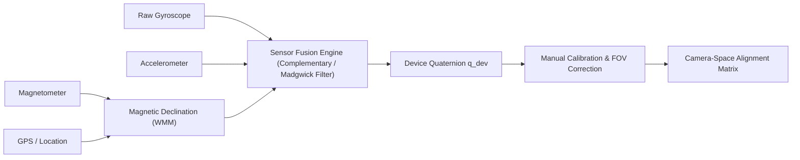

# SkyMap AR/VR: Version 2.0 Technical Implementation Blueprint
**Course:** CG_IP (CMP513 + CMP514: Computer Graphics & Image Processing)  
**Authors:** Nidhi Patel, Vansh Shah, Keya Patel  
**Document Version:** 2.0.0 (Comprehensive Engineering & Mathematical Specification)

---

## 1. Executive Summary & Vision

The **SkyMap AR/VR** project transforms a mobile web browser into an interactive, high-precision astronomical exploration system. Moving beyond single-body tracking (Sun and Moon), Version 2.0 elevates the system into a dual-mode **Augmented Reality (AR)** and **Virtual Reality (VR / WebXR)** celestial platform capable of real-time star identification, 88-constellation visualization, historical sky time-travel, planetary ephemerides, and light-pollution simulation.

```
                           SYSTEM EVOLUTION
  V1.0 (Baseline Prototype)                 V2.0 (Engineering Blueprint)
  ├── 2 Bodies (Sun & Moon)                 ├── 2,000+ Cataloged Stars (Hipparcos/Gaia)
  ├── 2D HTML5 Canvas                       ├── Dual Render Engine (Canvas 2D + WebGL/Three.js)
  ├── Basic Meeus Equations                 ├── Dual-Precision Ephemeris + Proper Motion
  ├── Raw DeviceOrientation                ├── Sensor Fusion (Gyro + Mag + Accel + WMM)
  └── Screen-space Arrow Tracking           ├── Smart Sky Recognition + WebXR VR + Time Travel
```

---

## 2. Mathematical Foundation & Astronomical Engine Upgrades

### 2.1 Quadrant-Safe Horizontal Transformation ($\text{atan2}$)
The azimuth angle $A$ must be evaluated using the two-argument arctangent ($\operatorname{atan2}$) to ensure unambiguous quadrant determination across the full $[0^\circ, 360^\circ)$ azimuth circle.

Given:
- Observer Latitude $\phi$, Longitude $\lambda$
- Standard Epoch J2000 Right Ascension $\alpha$, Declination $\delta$
- Local Hour Angle $HA = LST - \alpha$

$$\sin(h) = \sin(\phi)\sin(\delta) + \cos(\phi)\cos(\delta)\cos(HA)$$

$$A = \operatorname{atan2}\Big(-\sin(HA),\; \tan(\delta)\cos(\phi) - \sin(\phi)\cos(HA)\Big)$$

$$A_{\text{norm}} = (A \cdot \frac{180}{\pi} + 360) \pmod{360}$$

> [!IMPORTANT]
> Standard $\arctan$ produces identical results for opposite quadrants ($\pm 180^\circ$). Implementing $\operatorname{atan2}$ guarantees celestial bodies in the East ($HA < 0$) and West ($HA > 0$) never invert directions on the AR display.

---

### 2.2 Dual-Tier Precision Architecture
To balance real-time 60 FPS mobile rendering with academic astronomical precision, the engine adopts a two-tier architecture:

```
                            ASTRONOMY ENGINE
                                    │
           ┌────────────────────────┴────────────────────────┐
           ▼                                                 ▼
   [Tier 1: Fast Pipeline]                        [Tier 2: High-Precision]
   • Mobile sensor loop (60 FPS)                 • Deep exploration & historical dates
   • J2000 fixed coordinate cache                • IAU 2000/2006 precession & nutation
   • Simplified Meeus sidereal time              • UT1 - UTC ($\Delta T$) drift model
   • Local ENU matrix transform                  • Proper motion extrapolation
   • < 0.2 ms per frame CPU cost                 • Planetary VSOP87 orbital perturbations
```

#### Precession and Proper Motion Extrapolation
For stars with significant proper motion ($\mu_\alpha, \mu_\delta$) over elapsed centuries $T = (t - J2000) / 100$:

$$\alpha(t) = \alpha_0 + \mu_\alpha \cdot (t - 2000.0) + p_\alpha \cdot T$$
$$\delta(t) = \delta_0 + \mu_\delta \cdot (t - 2000.0) + p_\delta \cdot T$$

Where $p_\alpha, p_\delta$ represent standard general precession in equatorial coordinates:
$$p_\alpha = m + n \sin(\alpha)\tan(\delta), \quad p_\delta = n \cos(\alpha)$$
($m \approx 3.075\text{s/yr}, n \approx 1.336\text{s/yr}$ / $20.043''/\text{yr}$).

---

### 2.3 Coordinate Caching in Inertial Frame (ICRS)
A critical flaw of caching in ENU coordinates is that local ENU rotates continuously with the Earth.

**Corrected Architecture:**
1. **Inertial Unit Vectors (J2000 / ICRS)**: Computed once at startup for each star:
   $$\mathbf{v}_{\text{ICRS}} = \begin{bmatrix} \cos\delta \cos\alpha \\ \cos\delta \sin\alpha \\ \sin\delta \end{bmatrix}$$
2. **Local Transformation Matrix ($\mathbf{M}_{\text{sky}\to\text{ENU}}$)**: Recalculated periodically (every 1–2 seconds) from the observer's $LST$ and latitude $\phi$:
   $$\mathbf{v}_{\text{ENU}} = \mathbf{R}_x(90^\circ - \phi) \cdot \mathbf{R}_z(LST) \cdot \mathbf{v}_{\text{ICRS}}$$
3. **Camera Frame Projection (60 FPS)**: The device orientation matrix $\mathbf{R}_{\text{device}}$ transforms $\mathbf{v}_{\text{ENU}}$ directly into camera frustum space.

---

## 3. Astronomical Database Specification

### 3.1 Star Catalog Schema (`src/data/types.ts`)
Derived from the Yale Bright Star Catalog (BSC5) and Hipparcos datasets:

```typescript
export interface Star {
  id: string;               // Unique catalog key, e.g., "hip32349"
  hip?: number;             // Hipparcos identifier
  gaiaId?: string;          // Gaia DR3 identifier
  name?: string;            // Proper name: "Sirius", "Betelgeuse"
  bayer?: string;           // Bayer designation: "Alpha Canis Majoris"
  ra: number;               // Right Ascension (J2000, degrees: [0, 360))
  dec: number;              // Declination (J2000, degrees: [-90, +90])
  magnitude: number;        // Apparent visual magnitude (V)
  absoluteMagnitude?: number;
  distanceLightYears?: number;
  spectralType?: string;    // e.g., "A1V", "M2Iab"
  colorIndex?: number;      // B-V color index for true optical spectral rendering
  properMotionRA?: number;  // mas/year (milliarcseconds)
  properMotionDec?: number; // mas/year
  constellationId?: string; // IAU 3-letter abbreviation, e.g., "CMA"
}
```

### 3.2 Database Expansion Stages
| Stage | Catalog Scope | Magnitude Cutoff ($V$) | Constellations | Target Objects |
| :--- | :--- | :--- | :--- | :--- |
| **Initial** | Primary navigational stars | $V \le 3.5$ | 20 prominent asterisms | ~150 stars + Sun/Moon |
| **Intermediate** | All naked-eye stars (suburban) | $V \le 4.5$ | 50 constellations | ~500 stars + 5 naked-eye planets |
| **Advanced (Target)** | Complete naked-eye sphere | $V \le 5.8$ | **All 88 IAU Constellations** | **~2,000 stars + Messier DSO** |
| **Extended** | Rural dark sky / binocular | $V \le 6.5$ | All 88 + boundaries | ~5,000+ stars + satellites |

### 3.3 Deep-Sky Objects (Messier Catalog) & Planets
- **Planets (Analytical Keplerian / VSOP87 approximations)**: Mercury, Venus, Mars, Jupiter, Saturn.
- **Deep-Sky Objects (DSO)**: Andromeda Galaxy (M31), Orion Nebula (M42), Pleiades (M45), Hercules Globular Cluster (M13), Beehive Cluster (M44), Lagoon Nebula (M8).

---

## 4. System Architecture: Rendering Abstraction Layer

To ensure mobile performance without compromising high-end VR visuals, rendering is isolated behind a polymorphic interface:

```
                          ┌────────────────────────┐
                          │   IRenderer Interface  │
                          └───────────┬────────────┘
                                      │
            ┌─────────────────────────┼────────────────────────┐
            ▼                         ▼                        ▼
  ┌───────────────────┐    ┌─────────────────────┐   ┌───────────────────┐
  │  Canvas2DRenderer │    │   WebGLRenderer     │   │   WebXRRenderer   │
  │ • Lightweight 2D  │    │ • Three.js scene    │   │ • Immersive VR    │
  │ • Fast cold-start │    │ • GPU Instancing    │   │ • Stereo cameras  │
  │ • Passthrough AR  │    │ • Custom glow/bloom │   │ • Headset 6DOF    │
  └───────────────────┘    └─────────────────────┘   └───────────────────┘
```

```typescript
export interface IRenderer {
  init(container: HTMLElement, options: RenderOptions): Promise<void>;
  render(sceneData: SkySceneData, cameraMatrix: Float32Array): void;
  resize(width: number, height: number): void;
  setMode(mode: 'AR' | 'VR_PLANETARIUM' | 'VR_STEREO' | 'NIGHT_RED'): void;
  dispose(): void;
}
```

---

## 5. Sensor Fusion, Compass Calibration & AR Alignment



### 5.1 Magnetic Declination & True North Correction
On Android and desktop browsers, `DeviceOrientationEvent.alpha` is referenced to **Magnetic North**, which deviates from True North by several degrees depending on geographic location.
- Version 2.0 incorporates a low-order spherical harmonic World Magnetic Model (WMM) lookup based on GPS coordinates.
- On iOS Safari, `webkitCompassHeading` natively provides True North and does not double-correct.

### 5.2 Pre-Flight Compass Calibration Screen
Before activating AR passthrough, a modal calibration screen guides the user:
1. **Sensor Health Check**: Verifies if `DeviceOrientationEvent` or `DeviceMotionEvent` are active.
2. **Figure-8 Gesture Prompt**: Asks the user to rotate the phone in a figure-8 motion to calibrate the magnetometer.
3. **Manual Boresight Nudge**: A subtle onscreen azimuth micro-slider ($\pm 10^\circ$) allows manual touch alignment with known visual landmarks (or the Sun/Moon during twilight).

---

## 6. VR Architecture: Planetarium vs. Headset WebXR

### 6.1 Mode 1: 360° Mobile Planetarium Mode
- **Display**: High-resolution dark sky dome with procedural cosmic background and deep-space dust gradients.
- **Controls**: Dual input: gyro-based look-around on phones, or touch swipe / mouse drag on desktop laptops.
- **Atmosphere & Light Pollution Simulation**: Real-time Bortle scale adjustment:
  - *Urban (Bortle 8-9)*: Mag limit $\approx 3.0$, sky gray-blue ambient glow.
  - *Suburban (Bortle 5)*: Mag limit $\approx 4.8$, faint Milky Way invisible.
  - *Dark Sky (Bortle 1-2)*: Mag limit $\approx 6.5$, brilliant galactic core and thousands of pinprick stars.

### 6.2 Mode 2: Headset VR (WebXR Immersive Session)
- **Standardized WebXR API**: Requests `navigator.xr.requestSession('immersive-vr')` for Meta Quest, HTC Vive, or Apple Vision Pro.
- **Optical Infinity Parallax Correction**:
  > [!IMPORTANT]
  > Astronomical objects are millions of light years away. Applying artificial binocular convergence or exaggerated stereo displacement causes severe eye strain and optical distortion. Stars are rendered at optical infinity ($z \to \infty$) with identical angular direction vectors for both eyes, while UI cards and interactive HUD reticles sit at comfortable near-field depths (1.5–2.0 meters).

---

## 7. Advanced Intelligent Features

### 7.1 Smart Sky Recognition (Orientation Boresight Cone)
No heavy machine-learning model is required for the initial identification phase:
1. The camera boresight vector $\mathbf{v}_{\text{center}} = \begin{bmatrix} 0 & 0 & 1 \end{bmatrix}^T$ is transformed into celestial $(\alpha, \delta)$.
2. The engine performs an angular distance cone search:
   $$\theta = \arccos\Big(\sin\delta_1\sin\delta_2 + \cos\delta_1\cos\delta_2\cos(\alpha_1 - \alpha_2)\Big)$$
3. Any catalog star within the field of view ($\theta \le \frac{1}{2}\text{FOV}$) with $V_{\text{mag}} < \text{threshold}$ is automatically labeled on screen.

### 7.2 Dynamic Constellation Discovery
When the user sweeps the camera across an active constellation (e.g., Orion):
- The app detects prominent star proximity (Betelgeuse, Rigel, Bellatrix).
- Constellation lines animate sequentially star-by-star.
- A holographic information card reveals:
  - Latin name and English translation.
  - Principal star names and light-year distances.
  - Ancient mythological lore and seasonal visibility.

### 7.3 Sky Time Machine (Historical & Future Simulation)
A responsive time slider allows scrubbing across hours, months, or centuries:
- Watch the diurnal rotation of the sky dome in accelerated real-time.
- View the night sky on the user's birth date or during historical astronomical events (e.g., Great Comet of 1997, Apollo 11 moon landing).
- Demonstrates proper motion drift over millenia for fast stars (e.g., Barnard's Star, Sirius).

### 7.4 AR Angular Distance Measurement Tool
1. Tap Star A $\to$ lock reticle.
2. Tap Star B $\to$ lock reticle.
3. The engine draws a glowing geodesic arc on the canvas and computes:
   $$\Delta \theta = \arccos\big(\mathbf{v}_A \cdot \mathbf{v}_B\big)$$
4. Displays the angular separation in degrees, arcminutes, and arcseconds ($^\circ\,'\,''$), providing direct educational value in spherical astronomy.

---

## 8. Complete 9-Phase Development Roadmap

```mermaid
gantt
    title SkyMap AR/VR v2.0 Execution Timeline
    dateFormat  YYYY-MM-DD
    section Core Foundations
    Phase 1: Catalog Expansion (2,000 stars + 88 Constellations) :p1, 2026-11-25, 5d
    Phase 2: Astronomy Math Engine (Dual-precision, atan2, Proper Motion) :p2, after p1, 4d
    section Rendering Architecture
    Phase 3: WebGL & Canvas Abstraction Pipeline                 :p3, after p2, 6d
    Phase 4: Sensor Fusion, Calibration & AR Alignment           :p4, after p3, 5d
    section Immersive VR & Vision
    Phase 5: WebXR & 360° VR Planetarium                         :p5, after p4, 5d
    Phase 6: Image Enhancement & Computer Graphics Experiments  :p6, after p5, 4d
    section Intelligence & Polish
    Phase 7: Advanced Ephemerides, Planets & Time Slider        :p7, after p6, 5d
    Phase 8: Smart Sky Recognition & AR Measurement Arc         :p8, after p7, 4d
    Phase 9: Cross-Device Validation & Benchmark Matrix         :p9, after p8, 3d
```

### Detailed Phase Deliverables

| Phase | Title | Concrete Engineering Objectives | Exit Criteria |
| :---: | :--- | :--- | :--- |
| **1** | **Scalable Astronomical Catalog** | Build TS/JSON catalog of 2,000+ stars ($V \le 5.8$), 88 IAU constellation stick lines, and Messier deep-sky objects. | Catalog loads in $< 50\text{ms}$; zero missing star references in constellation graphs. |
| **2** | **Mathematical Precision Engine** | Implement quadrant-safe `atan2` azimuth, dual-tier precision, ICRS inertial caching, and proper motion. | Calculation of Sirius and Polaris Alt/Az matches Stellarium to within $0.05^\circ$ across 5 test cities. |
| **3** | **Dual Rendering Engine** | Implement `IRenderer` interface with Canvas 2D fallback and Three.js/WebGL GPU instanced star particles. | Smooth 60 FPS rendering of 2,000 stars with variable visual magnitude sizes and spectral colors. |
| **4** | **Sensor Fusion & Calibration** | Magnetometer declination lookup, complementary filter, and pre-flight figure-8 calibration modal. | Heading jitter reduced to $< 0.5^\circ$; zero drift when device is held stationary. |
| **5** | **VR & WebXR Platform** | 360° gyro/drag sky dome + WebXR immersive session with optical-infinity stereo consistency. | Tested in mobile browser and WebXR emulator; zero stereo convergence distortion on stars. |
| **6** | **Computer Graphics / IP Modules** | Contrast stretch, brightness filter on rear camera feed, and Sobel edge detection for physical horizon extraction. | Satisfies academic CG_IP criteria with togglable shader post-processing. |
| **7** | **Planetary & Time Travel Suite** | Keplerian orbital elements for 5 naked-eye planets + historical scrub slider with diurnal playback. | Accurately predicts Jupiter's position and planetary retrograde loops over historical dates. |
| **8** | **Smart Recognition & AR Arc** | Boresight cone detection for automatic constellation identification + two-star angular separation tool. | Tapping two stars draws a geodesic arc displaying the accurate angular separation. |
| **9** | **Verification & Benchmarks** | Cross-browser validation (iOS Safari, Android Chrome, Desktop) and performance profiling. | Sustained 60 FPS, battery usage $< 12\%/\text{hr}$, memory footprint $< 80\text{MB}$. |

---

## 9. Immediate Implementation Priorities (Top 10 Action Items)

```
[1] Implement quadrant-safe atan2 in src/astronomy.ts and validate against Stellarium
[2] Transition coordinate caching from local ENU to ICRS inertial unit vectors
[3] Build 2,000-star catalog with Hipparcos IDs and all 88 constellation stick figures
[4] Implement proper motion corrections for navigational benchmark stars (Sirius, Vega)
[5] Add magnetic declination lookup to fix Magnetic vs True North offset on Android
[6] Create pre-flight sensor calibration modal (Figure-8 gyro/compass alignment)
[7] Build IRenderer abstraction supporting Canvas 2D and Three.js/WebGL instancing
[8] Implement Smart Sky Recognition (boresight cone angular query)
[9] Construct 360° VR Planetarium mode with desktop touch/mouse drag simulation
[10] Add AR Angular Distance measurement tool (spherical geodesic arc)
```
